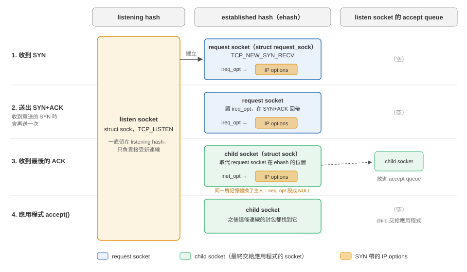
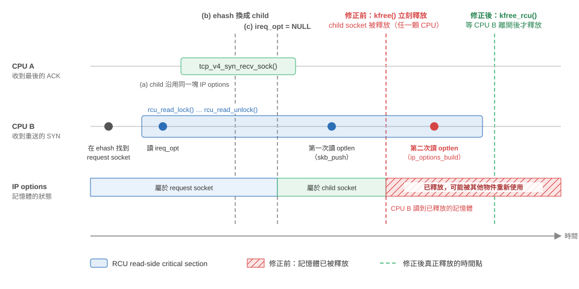

---
categories:
  - Linux
  - Networking
description: CVE-2026-98432 是 Linux kernel IPv4 TCP 三向交握過程中的 use-after-free，攻擊者不需權限，只要對 TCP listen socket 送出帶有 IP options 的封包並製造 race，就可能讓 kernel 讀寫已釋放的記憶體。本文以 Linux kernel 6.8.12 為基礎，分析漏洞成因、攻擊路徑與修正方式。
tags:
  - 技術分享
  - 資安
  - 原始碼分析
date: 2026-11-20
title: CVE-2026-98432：TCP 三向交握中的 use-after-free
draft: false
---
CVE-2026-98432 是 Linux kernel IPv4 TCP 在建立連線過程中的 use-after-free。攻擊者不需要任何權限，只要能連到一個 IPv4 的 TCP listen socket，送出帶有 IP options 的封包，並在時間點上製造 race，就有機會讓 kernel 讀寫已經被釋放的記憶體。

<!-- more -->

這個漏洞有不只一條觸發路徑，本文只詳細討論其中最基本、一般的 IPv4 TCP 伺服器都會走到的一條：同一條連線重送的 SYN 與最後的 ACK，同時在兩顆 CPU 上被處理。另一條路徑放在文章最後簡單補充。

本文以 Linux kernel 6.8.12 的原始碼為基礎，修正的部分則使用 upstream 的 patch。這個漏洞的成因與修正都跟 RCU 有關，文中提到的 RCU、grace period 與 `kfree_rcu()`，可以參考[前一篇 Linux Kernel RCU 介紹](https://blog.louisif.me/posts/linux-kernel-rcu-intro/)。

要看懂這個漏洞，得先知道 kernel 在 TCP 三向交握的過程中會用到哪三種 socket，以及 SYN 帶的 IP options 怎麼在它們之間傳遞、最後在哪裡被釋放。

## 三向交握中的 socket 與 IP options

應用程式對一個 socket 呼叫 `listen()` 之後，它就成為 listen socket（`struct sock`，狀態是 `TCP_LISTEN`）。kernel 會把所有 listen socket 放在一個以本機位址與 port 為 key 的 listening hash 裡，收到 SYN 時就從這裡找到對應的 listen socket。

listen socket 收到 SYN 之後，並不會馬上建立一個完整的 socket，而是先建立一個很小的 request socket（`struct request_sock`），記錄這條「還沒完成三向交握」的連線需要的資訊：雙方的位址與 port、初始序號、SYN 裡帶的 TCP options 等等。之所以要另外用一個小結構，是為了應付 SYN flood：攻擊者可以送出大量的 SYN 卻永遠不完成交握，如果每個 SYN 都配置一個完整的 socket，記憶體很快就會被耗盡。

完成三向交握之後，kernel 才會建立完整的 socket（`struct sock`）。原始碼裡常稱它為 child socket，因為它是從 listen socket 複製出來的。它會被放進 listen socket 的 accept queue，等應用程式呼叫 `accept()` 時拿走。

> 實際上被放進 accept queue 的是 request socket，然後有一個指標指向 child socket

三種 socket 之間的關係，可以從三向交握的每一步來看：



圖中橘色的 IP options，以及指向它的 `ireq_opt`、`inet_opt`，是這個漏洞的主角，後面會依序說明。

這裡要特別注意 request socket 放在哪裡。從 Linux 4.4 開始，request socket 跟已經建立好的連線一起放在 established hash（後面簡稱 ehash）裡，狀態是 `TCP_NEW_SYN_RECV`。

ehash 是以「來源位址、來源 port、目的位址、目的 port」四個值為 key 的 hash table，kernel 收到一般的 TCP 封包時，就是在這裡找對應的連線。

這樣設計的好處是，收到交握過程中的封包（例如最後的 ACK）時，kernel 直接在 ehash 就能找到 request socket，不需要先找到 listen socket、再到它底下去找。後面會看到，這個設計也讓處理 request socket 時不需要拿 listen socket 的 lock，而這正是漏洞的起點。

### 收到 SYN：建立 request socket

kernel 用 `struct sk_buff`（簡稱 skb）表示一個封包，IPv4 的 TCP 封包進來之後，都會交給 `tcp_v4_rcv()` 處理。收到 SYN 時，`tcp_v4_rcv()` 會在 listening hash 找到 listen socket，最後進入 `tcp_conn_request()`：

```c
/* net/ipv4/tcp_ipv4.c 第 2176 行，簡化後 */
/* tcp 處理函數的入口 */
int tcp_v4_rcv(struct sk_buff *skb)
{
    ...
lookup:
    /* 在 ehash 或 listening hash 找到對應的 socket */
    sk = __inet_lookup_skb(net->ipv4.tcp_death_row.hashinfo,
                           skb, __tcp_hdrlen(th), th->source,
                           th->dest, sdif, &refcounted);
    ...
	if (sk->sk_state == TCP_NEW_SYN_RECV) {
		...
		/* tcp_check_req 會呼叫到 tcp_conn_request */
		nsk = tcp_check_req(sk, skb, req, false, &req_stolen);
		...
    }
    ...
}
```

```c
/* net/ipv4/tcp_input.c 第 7091 行，簡化後 */
int tcp_conn_request(...)
{
    ...
    /* 配置 request socket，rsk_listener 指向 listen socket */
    req = inet_reqsk_alloc(rsk_ops, sk, !want_cookie);
    ...
    /* 記錄位址，並把 SYN 裡的 IP options 存起來 */
    dst = af_ops->route_req(sk, skb, &fl, req);
    ...
    /* 放進 ehash */
    inet_csk_reqsk_queue_hash_add(sk, req, req->timeout);
    ...
    /* 送出 SYN+ACK（IPv4 實際呼叫的是 tcp_v4_send_synack()） */
    af_ops->send_synack(sk, dst, &fl, req, &foc, ...);
    ...
}
```

`af_ops` 是依 IPv4、IPv6 而不同的一組函式，IPv4 實際呼叫的是 `tcp_v4_route_req`。request socket 建立之後就被放進 ehash，接著送出 SYN+ACK。

### IP options 與 `ireq_opt`

這個漏洞的主角，是 SYN 封包裡的 IP options。

IPv4 header 的長度是可變的。固定的部分是 20 bytes，後面可以接最多 40 bytes 的 IP options，例如記錄封包經過哪些路由器的 Record Route，或是記錄時間戳記的 Timestamp。這些是 IP 層的 options，跟 TCP header 裡的 TCP options（MSS、window scale 等）是兩回事，一般的網路流量幾乎不會用到。

如果 SYN 帶了 IP options，伺服器回應這條連線的封包也可能要帶上對應的 options。例如 RFC 1122 規定，被動開啟的連線收到帶 Source Route 的封包時，之後送出的封包都要沿原路反向送回。所以 kernel 收到 SYN 時，會在 `tcp_v4_route_req()` 呼叫的 `tcp_v4_init_req()` 裡，把這些 options 轉換成回應時要用的版本，存進 request socket 的 `ireq_opt`：

```c
/* net/ipv4/tcp_ipv4.c 第 1661 行，簡化後 */
static void tcp_v4_init_req(struct request_sock *req,
                            const struct sock *sk_listener,
                            struct sk_buff *skb)
{
	/* 建立 request socket */
    struct inet_request_sock *ireq = inet_rsk(req);
    ...
    /* 初始化 ireq_opt */
    RCU_INIT_POINTER(ireq->ireq_opt, tcp_v4_save_options(net, skb));
}

/* include/net/tcp.h 第 2401 行 */
static inline struct ip_options_rcu *tcp_v4_save_options(struct net *net,
                                                         struct sk_buff *skb)
{
    /* IP 層收到封包時，已經把解析出的 IP options 記在 skb 上 */
    const struct ip_options *opt = &TCP_SKB_CB(skb)->header.h4.opt;
    struct ip_options_rcu *dopt = NULL;

    /* SYN 有帶 IP options 才配置記憶體 */
    if (opt->optlen) {
        int opt_size = sizeof(*dopt) + opt->optlen;

        dopt = kmalloc(opt_size, GFP_ATOMIC);
        /* 轉換成回應時要帶的版本 */
        if (dopt && __ip_options_echo(net, &dopt->opt, skb, opt)) {
            kfree(dopt);
            dopt = NULL;
        }
    }
    return dopt;
}
```

`ireq_opt` 指向的是一塊用 `kmalloc()` 配置的 `struct ip_options_rcu`，這個指標是受 RCU 保護的：

```c
/* include/net/inet_sock.h，簡化後 */
struct ip_options_rcu {
    struct rcu_head rcu;
    struct ip_options opt;
};

struct inet_request_sock {
    struct request_sock req;
    ...
    struct ip_options_rcu __rcu *ireq_opt;
};
```

`inet_request_sock` 是 request socket 在 IP 層的外層結構，程式碼裡常用 `inet_rsk(req)` 把 request socket 轉成這個型別，才能存取 `ireq_opt`。設定指標用的 `RCU_INIT_POINTER()` 是不帶 memory barrier 的 `rcu_assign_pointer()`，這時 request socket 還沒放進 ehash，其他 CPU 看不到它，所以不需要 barrier。

送出 SYN+ACK 時，`tcp_v4_send_synack()` 就會讀這個 `ireq_opt`，把 options 放進 IP header：

```c
/* net/ipv4/tcp_ipv4.c 第 1169 行，簡化後 */
static int tcp_v4_send_synack(...)
{
    const struct inet_request_sock *ireq = inet_rsk(req);
    ...
    if (skb) {
        ...
        rcu_read_lock();
        err = ip_build_and_send_pkt(skb, sk, ireq->ir_loc_addr,
                                    ireq->ir_rmt_addr,
                                    rcu_dereference(ireq->ireq_opt),
                                    tos);
        rcu_read_unlock();
        ...
    }

    return err;
}
```

讀取的一方用的是標準的 RCU 寫法：`rcu_read_lock()` 進入 read-side critical section，用 `rcu_dereference()` 取得指標。照 RCU 的規則，這樣在 critical section 裡讀到的 `ireq_opt` 不是 NULL，就是指向有效的資料。不過這個保證有個前提：釋放的一方也要遵守規則，先把指標拿掉，等 grace period 結束才釋放記憶體。

### 收到最後的 ACK：建立 child socket

接著看三向交握的最後一步。收到 ACK 時，`tcp_v4_rcv()` 在 ehash 裡找到的是 request socket，於是走進專門處理 `TCP_NEW_SYN_RECV` 的分支：

```c
/* net/ipv4/tcp_ipv4.c 第 2176 行，簡化後 */
int tcp_v4_rcv(struct sk_buff *skb)
{
    ...
lookup:
    /* 在 ehash 或 listening hash 找到對應的 socket */
    sk = __inet_lookup_skb(net->ipv4.tcp_death_row.hashinfo,
                           skb, __tcp_hdrlen(th), th->source,
                           th->dest, sdif, &refcounted);
    ...
    if (sk->sk_state == TCP_NEW_SYN_RECV) {
        /* 找到的是 request socket，lookup 時已經對它拿了一個 reference */
        struct request_sock *req = inet_reqsk(sk);
        bool req_stolen = false;
        struct sock *nsk;

        /* 從這裡開始，sk 指的是 request socket 所屬的 listen socket */
        sk = req->rsk_listener;
        ...
        /* 沒有拿 listen socket 的 lock，直接處理這個 request socket */
        nsk = tcp_check_req(sk, skb, req, false, &req_stolen);
        ...
    }
    ...
}
```

這段程式碼裡值得注意的是：從找到 request socket 到呼叫 `tcp_check_req()`，kernel 都沒有拿 listen socket 的 lock。在 Linux 4.4 之前，request socket 是放在 listen socket 自己的表裡，處理時要先拿 listen socket 的 lock，同一個 listen socket 底下的交握是一個一個處理的。4.4 把 request socket 移到 ehash 之後，listen socket 不再是瓶頸，但也代表**同一個 request socket 的封包，可以同時在不同的 CPU 上被處理**。

`tcp_check_req()` 負責依照封包內容決定要做什麼。如果是完成交握的合法 ACK，它會做兩件事：先建立 child socket，再把 child socket 交給 listen socket：

```c
/* net/ipv4/tcp_minisocks.c 第 646 行，簡化後 */
struct sock *tcp_check_req(...)
{
    ...
    /* 檢查序號、flag 等，確認這是完成交握的合法 ACK */
    ...
    /*
     * 建立 child socket，並在 ehash 裡用它取代 request socket。
     * IPv4 對應的是 tcp_v4_syn_recv_sock()。
     */
    child = inet_csk(sk)->icsk_af_ops->syn_recv_sock(sk, skb, req, NULL,
                                                     req, &own_req);
    ...
    /* 收尾：把 child 放進 accept queue */
    return inet_csk_complete_hashdance(sk, child, req, own_req);
}
```

接著看建立 child socket 的 `tcp_v4_syn_recv_sock()`，裡面跟 IP options 有關的三個步驟，分別標成 (a)、(b)、(c)：

```c
/* net/ipv4/tcp_ipv4.c 第 1736 行，簡化後 */
struct sock *tcp_v4_syn_recv_sock(...)
{
    ...
    /* 從 listen socket 複製出 child socket */
    newsk = tcp_create_openreq_child(sk, req, skb);
    ...
    /* (a) child 直接沿用 request socket 的 IP options：只複製指標，沒有複製內容 */
    inet_opt = rcu_dereference(ireq->ireq_opt);
    RCU_INIT_POINTER(newinet->inet_opt, inet_opt);
    ...
    /* (b) 在 ehash 裡用 child 取代 request socket；own_req 表示取代成功 */
    *own_req = inet_ehash_nolisten(newsk, req_to_sk(req_unhash),
                                   &found_dup_sk);
    if (likely(*own_req)) {
        tcp_move_syn(newtp, req);
        /* (c) 這塊記憶體從此歸 child 所有，request socket 不再指向它 */
        ireq->ireq_opt = NULL;
    }
    ...
    return newsk;
}
```

這裡發生了一件關鍵的事：**IP options 的記憶體換了主人**。(a) 先讓 child socket 的 `inet_opt` 指向 request socket 原本的那塊記憶體；(b) 接著 `inet_ehash_nolisten()` 在 ehash 裡用 child socket 取代 request socket，之後同一條連線的封包就會找到 child socket；(c) 最後 `ireq->ireq_opt` 才被設成 NULL。從此以後，這塊記憶體由 child socket 負責釋放。

接著 `tcp_check_req()` 呼叫 `inet_csk_complete_hashdance()` 收尾，把 child socket 放進 listen socket 的 accept queue，等應用程式呼叫 `accept()` 拿走。

### 釋放 IP options

最後看釋放的部分。IP options 交給 child socket 之後，會在 child socket 被釋放時，由 `inet_sock_destruct()` 一起釋放：

```c
/* net/ipv4/af_inet.c 第 133 行，簡化後 */
void inet_sock_destruct(struct sock *sk)
{
    struct inet_sock *inet = inet_sk(sk);
    ...
    /* 第二個參數 1：socket 正在解構，不會再有人更新這個指標 */
    kfree(rcu_dereference_protected(inet->inet_opt, 1));
    ...
}
```

這裡用的是一般的 `kfree()`，會立刻釋放記憶體，沒有等 grace period。

kernel 有現成的機制可以讓 `inet_sock_destruct()` 晚一點執行：socket 的 `SOCK_RCU_FREE` flag。socket 釋放時會呼叫 `sk_destruct()`，帶有這個 flag 的 socket，整個解構流程都會用 `call_rcu()` 延到 grace period 結束之後才執行，`inet_sock_destruct()` 裡的 `kfree()` 自然也會跟著延後：

```c
/* net/core/sock.c，簡化後 */
void sk_destruct(struct sock *sk)
{
    bool use_call_rcu = sock_flag(sk, SOCK_RCU_FREE);
    ...
    if (use_call_rcu)
        /* 等 grace period 結束後才呼叫 __sk_destruct() */
        call_rcu(&sk->sk_rcu, __sk_destruct);
    else
        /* 立刻呼叫，__sk_destruct() 會再呼叫 inet_sock_destruct() */
        __sk_destruct(&sk->sk_rcu);
}
```

問題是 child socket 沒有這個 flag。listen socket 加入 listening hash 時會設定 `SOCK_RCU_FREE`；但 child socket 是從 listen socket 複製出來的，複製時會刻意把它清掉：

```c
/* net/ipv4/inet_hashtables.c，__inet_hash() 裡，listen socket 加入 listening hash 時 */
    sock_set_flag(sk, SOCK_RCU_FREE);

/* net/ipv4/inet_connection_sock.c 第 1164 行，inet_csk_clone_lock()，節錄 */
        /* listeners have SOCK_RCU_FREE, not the children */
        sock_reset_flag(newsk, SOCK_RCU_FREE);
```

`inet_csk_clone_lock()` 就是前面 `tcp_create_openreq_child()` 複製 listen socket 時呼叫的函式。所以 child socket 被釋放時，`inet_sock_destruct()` 會立刻執行，`inet_opt` 也跟著被立刻釋放，沒有任何東西會等 RCU 的讀取者。只要有讀取者在 RCU 保護下拿到這塊 IP options，卻沒有對 child socket 持有任何 reference，就會遇到前一篇「生命週期問題」描述的 use-after-free：讀取者還在 critical section 裡使用指標，記憶體已經被 free 掉。

## 漏洞的攻擊路徑

前面已經看到兩個條件：同一個 request socket 的封包可以在不同 CPU 上同時處理，而 IP options 的記憶體在建立 child socket 時換了主人，並且會被立刻釋放。接下來看這兩個條件怎麼撞在一起。

### 重送的 SYN 與最後的 ACK 同時抵達

`tcp_check_req()` 除了處理 ACK，也會處理重送的 SYN。客戶端如果沒收到 SYN+ACK，會再送一次 SYN；伺服器在 ehash 找到 request socket 後，會在 `tcp_check_req()` 裡辨認出這是重送的 SYN，再回一次 SYN+ACK：

```c
/* net/ipv4/tcp_minisocks.c 第 646 行，簡化後 */
struct sock *tcp_check_req(...)
{
    ...
    /* 序號跟原本的 SYN 相同、而且只帶 SYN flag：這是重送的 SYN */
    if (TCP_SKB_CB(skb)->seq == tcp_rsk(req)->rcv_isn &&
        flg == TCP_FLAG_SYN && ...) {
        ...
        /* 重送 SYN+ACK：最後會呼叫到 tcp_v4_send_synack() */
        inet_rtx_syn_ack(sk, req);
        ...
        return NULL;
    }
    ...
}
```

假設 CPU A 正在處理最後的 ACK，CPU B 同時在處理同一條連線重送的 SYN。CPU A 在建立 child socket 後，會把 ehash 裡的 request socket 替換成 child socket，並把 request socket 的 `ireq_opt` 設成 NULL。

只要 CPU B 在 CPU A 做到這兩步之前，從 ehash 拿到 request socket 並拿到 `ireq_opt` 指標，就可以在 CPU A 清掉 ehash 和 `ireq->ireq_opt` 之後，才去讀這塊 IP options 的內容。重送 SYN 的分支不會再檢查一次它是否已經被 child socket 取代，直接重送 SYN+ACK。

```
[CPU A] 收到最後的 ACK
  tcp_v4_rcv()
    __inet_lookup_skb()                     在 ehash 找到 request socket
    tcp_check_req()
      tcp_v4_syn_recv_sock()
        (a) child->inet_opt = req->ireq_opt   IP options 交給 child
        (b) inet_ehash_nolisten()             在 ehash 用 child 取代 request socket
        (c) req->ireq_opt = NULL

[CPU B] 同時收到同一條連線重送的 SYN
  tcp_v4_rcv()
    __inet_lookup_skb()                     在 (b) 之前找到 request socket，拿 reference
    tcp_check_req()
      inet_rtx_syn_ack() → ... → tcp_v4_send_synack()
        rcu_read_lock()
        opt = rcu_dereference(req->ireq_opt)    在 (c) 之前讀到指標
        ip_build_and_send_pkt(..., opt, ...)    child socket 若在這之前被釋放，opt 已指向釋放的記憶體
        rcu_read_unlock()

[任一顆 CPU] child socket 被關閉、釋放
  inet_sock_destruct()
    kfree(child->inet_opt)                  立刻釋放 IP options
```

在 CPU A 完成連線建立後，只要 child socket 在 CPU B 用完這塊 IP options 之前被釋放，就會觸發漏洞。child socket 什麼時候被釋放，取決於伺服器端怎麼處理這條連線，例如應用程式 `accept()` 之後馬上關閉。條件成立時，`inet_sock_destruct()` 會立刻 `kfree()` 這塊記憶體，從這一刻起到 CPU B 呼叫 `rcu_read_unlock()` 為止，CPU B 每一次讀取這塊記憶體都是 use-after-free。CPU B 雖然對 request socket 持有 reference，但那只保證 request socket 本身不會被釋放，保護不到這塊已經換了主人的 IP options。

CPU B 用到這塊記憶體的地方，是 `ip_build_and_send_pkt()` 與它呼叫的 `ip_options_build()`。這兩個函式會多次讀取 IP options 的長度 `optlen`，其中跟漏洞有關的是下面標出的兩次。skb 的資料前面會預留一段空間，送出封包時，各層用 `skb_push()` 往前擴展，放進自己的 header：

```c
/* net/ipv4/tcp_ipv4.c 第 1169 行，簡化後 */
static int tcp_v4_send_synack(...)
{
    const struct inet_request_sock *ireq = inet_rsk(req);
    ...
    if (skb) {
        ...
        rcu_read_lock();
        /* 以下都是在 RCU 的保護範圍 */
        err = ip_build_and_send_pkt(skb, sk, ireq->ir_loc_addr,
                                    ireq->ir_rmt_addr,
                                    /* 在 CPU A 執行 (c) 之前讀到指標 */
                                    rcu_dereference(ireq->ireq_opt),
                                    tos);
        rcu_read_unlock();
        ...
    }

    return err;
}

/* net/ipv4/ip_output.c 第 149 行，簡化後 */
int ip_build_and_send_pkt(...)
{
    ...
    /* 第一次讀 optlen：用 skb_push() 在封包前面預留 IP header 加上 options 的空間 */
    /* child socket 在這之前被釋放，這裡讀到的就已經是已釋放的記憶體 */
    skb_push(skb, sizeof(struct iphdr) + (opt ? opt->opt.optlen : 0));
    ...
    if (opt && opt->opt.optlen) {
        ...
        ip_options_build(skb, &opt->opt, daddr, rt);
    }
    ...
}

/* net/ipv4/ip_options.c 第 44 行，簡化後 */
void ip_options_build(...)
{
    unsigned char *iph = skb_network_header(skb);
    ...
    /* 第二次讀 optlen：決定要複製多少 bytes 的 options 進 IP header */
    /* 記憶體如果在兩次讀取之間被釋放、又被重新使用，這裡的 optlen 可能跟第一次不同 */
    memcpy(iph + sizeof(struct iphdr), opt->__data, opt->optlen);
    ...
}
```

實際會造成什麼後果，取決於這塊記憶體有沒有被 kernel 拿去給其他物件使用。如果還沒被重新使用，內容通常還是原本的值，封包會照常送出，表面上看不出異常。一旦被重新使用，`optlen` 就可能變成任意的值。

最明顯的情況是記憶體在兩次讀取之間被重新使用，兩次讀到的 `optlen` 不一樣：預留的空間是依照第一次的值，複製的長度卻依照第二次的值，可能寫超出預留的範圍。就算是在第一次讀取之前就被改掉、兩次讀到同一個值，也一樣危險。`optlen` 的型別是 `unsigned char`，最大可以到 255，遠超過 IP options 合法的 40 bytes，`skb_push()` 可能因此超出 skb 預留的空間，讓 kernel 直接當掉；`memcpy()` 也會把其他物件的內容放進封包，送給對方。

這幾個時間點都很短，每條連線也只有一次機會，所以攻擊者需要不斷建立新的連線，每次都讓最後的 ACK 與重送的 SYN 幾乎同時抵達。

把兩顆 CPU 和 IP options 記憶體的狀態依時間排在一起，就是下圖。圖中也標出了下一節修正之後，記憶體真正被釋放的時間點：



## 修正方式

修正的 patch 非常短，只把兩個釋放 IP options 的地方，從 `kfree()` 改成 `kfree_rcu()`：

```diff
--- a/net/ipv4/af_inet.c
+++ b/net/ipv4/af_inet.c
@@ ... @@ void inet_sock_destruct(struct sock *sk)
-	kfree(rcu_dereference_protected(inet->inet_opt, 1));
+	kfree_rcu(rcu_dereference_protected(inet->inet_opt, 1), rcu);
--- a/net/ipv4/tcp_ipv4.c
+++ b/net/ipv4/tcp_ipv4.c
@@ ... @@ static void tcp_v4_reqsk_destructor(struct request_sock *req)
-	kfree(rcu_dereference_protected(inet_rsk(req)->ireq_opt, 1));
+	kfree_rcu(rcu_dereference_protected(inet_rsk(req)->ireq_opt, 1), rcu);
```

第一處 `inet_sock_destruct()` 就是本文討論的路徑；第二處 `tcp_v4_reqsk_destructor()` 是 request socket 被釋放時釋放 IP options 的地方，修的是最後補充的另一條路徑。

`kfree_rcu()` 的第二個參數 `rcu`，就是前面看到的 `struct ip_options_rcu` 裡的 `struct rcu_head`。改用 `kfree_rcu()` 之後，IP options 不會被立刻釋放，而是等一個 grace period 結束之後才釋放。

套回前面的攻擊路徑：CPU B 讀取 `ireq_opt` 到使用完畢，整段都在 `rcu_read_lock()` 與 `rcu_read_unlock()` 之間。依照前一篇介紹的 RCU 保證，grace period 一定會等到所有在它開始前就存在的 read-side critical section 結束，所以 child socket 釋放時呼叫的 `kfree_rcu()`，一定會等到 CPU B 呼叫 `rcu_read_unlock()` 之後，才真正釋放記憶體。

為什麼只改這兩處？commit message 的說明是：讀取的一方本來就都在 RCU 保護下讀取，而其他會替換 `inet_opt` 的程式碼，例如用 `setsockopt()` 設定 IP options 的 `do_ip_setsockopt()`、設定 CIPSO 標籤的 `cipso_v4_sock_setattr()`，本來就用 `kfree_rcu()` 釋放舊的 options。這次修正讓這兩個解構函式也改用 `kfree_rcu()`，跟其他程式碼一致。

修正 commit 帶有兩個 `Fixes:` tag。第一個是 Linux 4.4 的 commit `079096f103fa`：從這個 commit 開始，處理 request socket 不再需要拿 listen socket 的 lock，CPU A 與 CPU B 才有機會同時處理同一個 request socket，本文討論的路徑就是從這時開始存在。第二個對應最後補充的另一條路徑：

```
Fixes: 079096f103fa ("tcp/dccp: install syn_recv requests into ehash table")
Fixes: c905dee62232 ("tcp: Migrate TCP_NEW_SYN_RECV requests at retransmitting SYN+ACKs.")
```

stable 分支會依照這些 tag 判斷哪些版本需要 backport。實際修正的 kernel 版本，請以各發行版的安全公告為準。

## 升級之前的緩解措施

根本的解法是升級到包含修正的 kernel。在還沒辦法重開機的情況下，Red Hat 的公告提供了一個暫時的緩解方式：用 nftables 丟掉所有帶有 IP options 的 IPv4 TCP 封包。

```
table inet cve_2026_98432 {
    chain input {
        type filter hook input priority -310; policy accept;
        ip protocol tcp ip hdrlength > 5 counter drop
    }
}
```

IPv4 header 的長度欄位是以 4 bytes 為單位，沒有任何 options 時是 5，也就是 20 bytes。`ip hdrlength > 5` 表示 header 後面還接了 IP options。因為漏洞必須靠 SYN 帶 IP options 才能觸發，擋掉這類封包之後，經過這條規則的 SYN 都不會帶 IP options，request socket 的 `ireq_opt` 也就一定是 NULL。前面提過一般流量幾乎不會用到 IP options，所以通常不受影響，但還是建議先確認自己環境的流量。

這條規則有幾個限制：它不會在重開機後保留；它只作用在主機的 network namespace，例如 Red Hat 指出 OpenShift 上 OVN-Kubernetes 的 pod 對 pod 流量就不會被過濾；而且它只是降低風險，不能取代升級 kernel。升級完成後，可以用 `nft delete table inet cve_2026_98432` 把規則移除。

## 補充：另一條觸發路徑與 MPTCP

另一條觸發路徑跟 request socket 的遷移有關。多個 socket 可以用 `SO_REUSEPORT` 同時 listen 在同一個 port 上；開啟 `net.ipv4.tcp_migrate_req=1`，或是掛上 `BPF_SK_REUSEPORT_SELECT_OR_MIGRATE` 類型的 BPF 程式之後，其中一個 listen socket 被關閉時，它底下還沒完成交握的 request socket 就可以遷移到同一組裡其他還開著的 listen socket。遷移發生在 request socket 的 SYN+ACK 重送 timer 觸發時：kernel 會複製出一個新的 request socket，新舊兩個指向同一塊 IP options，接著把舊的那個清成 NULL，跟本文討論的路徑一樣是「換主人」。如果另一顆 CPU 還拿著舊 request socket 的 reference，正在用這塊 IP options 送 SYN+ACK 或建立 child socket，而新的 request socket 剛好被釋放，`tcp_v4_reqsk_destructor()` 就會用 `kfree()` 立刻收回記憶體。這條路徑在 Linux 5.14 加入 request socket 遷移時引入，只有開啟遷移功能的系統才會遇到，修正就是前面 patch 的第二處修改。

另外，Red Hat 公告中提到的公開攻擊示範，對象是有 MPTCP（Multipath TCP，讓一條連線可以同時使用多條網路路徑的 TCP 擴充）listener 的伺服器，而從 Go 1.24 開始，Go 程式在 Linux 上預設會開啟 MPTCP listener。不過漏洞的根本原因在一般的 IPv4 TCP 處理路徑上，Red Hat 的公告也指出 MPTCP 不是必要條件，所以關閉 MPTCP（`net.mptcp.enabled=0`）只能擋掉公開示範的那一種攻擊方式，不能取代升級 kernel。

## 參考資料

- 修正 commit：[ipv4: free inet_opt and ireq_opt after an RCU grace period](https://git.kernel.org/pub/scm/linux/kernel/git/torvalds/linux.git/commit/?id=e3f33b0a1d89)
- Red Hat 安全公告：[RHSB-2026-016](https://access.redhat.com/security/vulnerabilities/RHSB-2026-016)
- [CVE-2026-98432 - Red Hat Customer Portal](https://access.redhat.com/security/cve/cve-2026-98432)
