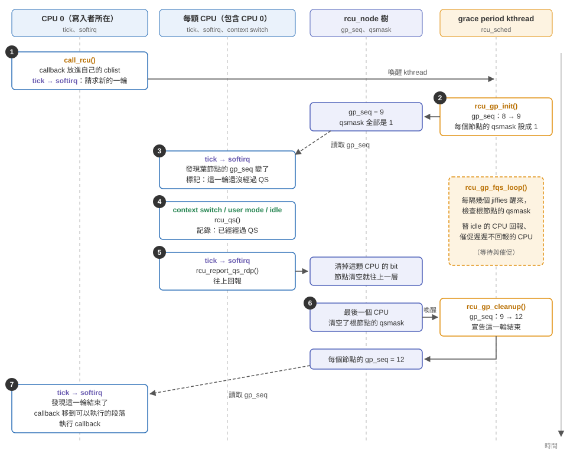
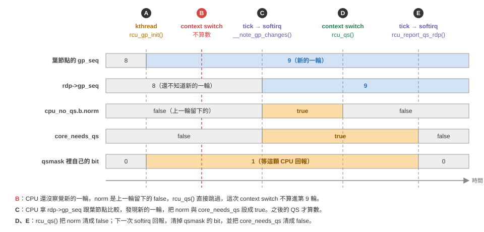
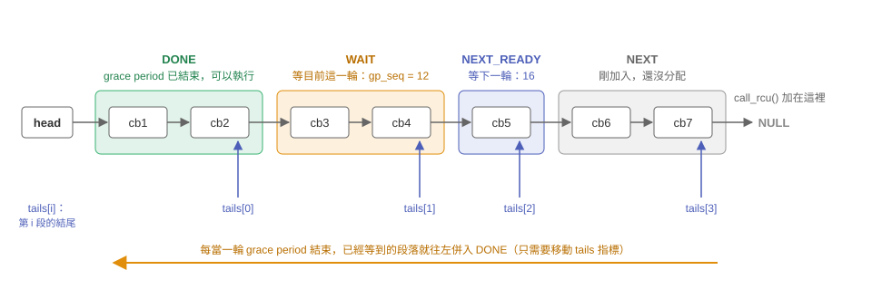
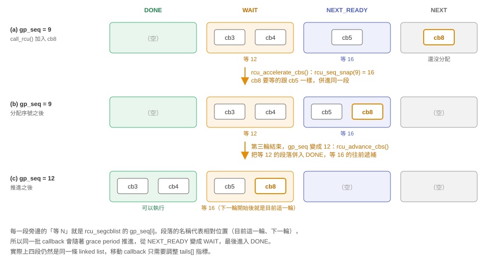

---
categories:
  - Linux
description: 延續 Linux Kernel RCU 介紹，以 Linux kernel 6.8.12 的原始碼為基礎，照著一輪 grace period 的七個步驟，逐一說明 grace period kthread、tick 與 RCU_SOFTIRQ 如何推進 grace period、回報 quiescent state，以及 callback 如何分段等待並被執行。
tags:
  - 技術分享
  - 原始碼分析
date: 2026-11-20
title: Linux Kernel RCU 原始碼解析
draft: false
---
這篇是 [Linux Kernel RCU 介紹](https://blog.louisif.me/posts/linux-kernel-rcu-intro/)的下一篇。上一篇從 RCU 要解決的問題講起，說明了 grace period 與 quiescent state 的概念，以及 kernel 實作 RCU 用到的資料結構與一輪 grace period 的七個步驟。這篇接著照這七個步驟看原始碼，看 grace period kthread、tick 與 softirq 怎麼把整個流程串起來。

<!-- more -->

本文以 Linux kernel 6.8.12 的原始碼為基礎，只討論不可搶佔的 kernel（`CONFIG_PREEMPTION=n`）。主線假設每顆 CPU 都持續收到 tick，CPU idle 時停掉 tick 的 `CONFIG_NO_HZ_IDLE` 放在最後補充。

## 複習：資料結構、角色與七個步驟

先簡單複習上一篇介紹的架構，後面的程式碼會不斷用到。

一顆 CPU 只要經過 context switch、user mode 或 idle，就表示它一定不在 read-side critical section 裡，這稱為 quiescent state（QS）。一輪 grace period 要等所有 CPU 都經過至少一次 QS 才算結束，寫入者註冊的 callback，則要等一輪在它註冊之後才開始的 grace period 結束才能執行。

kernel 用三層結構記錄 grace period 的進度。全域的 `struct rcu_state` 記錄目前的 grace period 序號 `gp_seq`；底下是一棵 `struct rcu_node` 樹，每個節點用 `qsmask` 的 bit 記錄還有哪些子節點或 CPU 沒回報 QS。之所以做成樹，是為了避免所有 CPU 搶同一個 lock：每顆 CPU 只鎖自己所屬的葉節點，節點的 `qsmask` 清空時才由最後一個回報的 CPU 往上層回報。最下面每顆 CPU 有自己的 `struct rcu_data`，記錄這顆 CPU 知道的 `gp_seq`、這一輪是否還需要它回報（`core_needs_qs`）、這一輪是否還沒經過 QS（`cpu_no_qs`），以及它的 callback queue（`cblist`）。

`rcu_data` 有一條重要的規則：記錄 grace period 進度的欄位與 callback queue，只由那顆 CPU 自己修改，其他 CPU 和 kthread 都不會去寫它們。需要跟其他 CPU 共享的資訊，則透過有 lock 保護的 `rcu_node` 樹往上傳遞。

`gp_seq` 其實有三份：`rcu_state` 一份、每個 `rcu_node` 各一份、每顆 CPU 的 `rcu_data` 各一份。kthread 負責更新 `rcu_state` 與 `rcu_node` 裡的 `gp_seq`；每顆 CPU 則拿自己 `rcu_data` 裡的那份，跟所屬葉節點的那份比較，不一樣就表示有一輪開始或結束了。

更新這些資料的有三個角色：負責宣告一輪開始與結束的 grace period kthread（在不可搶佔的 kernel 裡叫 `rcu_sched`）、每顆 CPU 各自的計時器中斷 tick（每秒觸發 `HZ` 次，kernel 用 `jiffies` 記錄經過了幾個 tick，1 個 jiffy 就是 1/`HZ` 秒），以及 tick 發現有事要做時觸發的 `RCU_SOFTIRQ`。一輪 grace period 的七個步驟是：

1. 寫入者呼叫 `call_rcu()`，callback 被放進這顆 CPU 的 `cblist`。這顆 CPU 在 tick 時發現自己有 callback 在等 grace period，主動請求開始新的一輪，喚醒 kthread。
2. kthread 推進 `gp_seq`，並把整棵樹的 `qsmask` 設成「所有 CPU 都還沒回報」。
3. 每顆 CPU 在 tick 時發現 `gp_seq` 變了，在觸發的 softirq 裡把自己的 `core_needs_qs` 標記成「這一輪還沒經過 QS」。
4. CPU 之後經過 context switch、user mode 或 idle 時，使用 `cpu_no_qs` 記錄自己已經經過 QS。
5. CPU 在下一次 tick 觸發的 softirq 裡，發現自己經歷了 QS 而且還沒回報，就沿著 `rcu_node` 樹往上回報，清掉自己在 `qsmask` 裡的 bit。
6. 最後一個回報的 CPU 清空了根節點的 `qsmask`，喚醒 kthread。kthread 推進 `gp_seq`，宣告這一輪結束。
7. 每顆 CPU 發現這一輪結束，把等待這一輪的 callback 移到「可以執行」的位置，在 softirq 裡執行它們。



圓圈裡的數字對應上面的步驟。除了步驟 1 與 6 透過 `rcu_state` 的 `gp_flags` 喚醒 kthread 之外，CPU 與 kthread 之間不直接交換資料，其餘共享的狀態都放在中間的 `rcu_node` 樹上。

接下來就從步驟 2 開始依序看程式碼。步驟 1 跟步驟 7 都跟 callback queue 有關，留到最後「Callback 的實現」一起說明；步驟 5 與 6 之間，還會插入一段 kthread 如何處理遲遲不回報的 CPU。

## Grace period 的實現

### Grace period kthread

先從 grace period kthread 開始。它的主迴圈 `rcu_gp_kthread()` 結構很清楚，就是三個階段的無窮迴圈：

```c
/* kernel/rcu/tree.c 第 1836 行，簡化後 */
for (;;) {
    /* 等待有人要求新的 grace period，然後初始化 */
    swait_event_idle_exclusive(rcu_state.gp_wq,
            READ_ONCE(rcu_state.gp_flags) & RCU_GP_FLAG_INIT);
    if (rcu_gp_init())
        ...
    /* 等所有 CPU 回報 QS，必要時主動催促 */
    rcu_gp_fqs_loop();
    /* 收尾，宣告 grace period 結束 */
    rcu_gp_cleanup();
}
```

kthread 平常睡在 `rcu_state.gp_wq` 上，有 CPU 請求新一輪的 grace period 時，則透過在 `rcu_state.gp_flags` 設定 `RCU_GP_FLAG_INIT` 並喚醒它。

### 步驟 2，開始新的一輪：`rcu_gp_init()`

`rcu_gp_init()` 會推進 `rcu_state.gp_seq`，並沿著樹把每個 `rcu_node` 的 `qsmask` 設成「每個線上 CPU 都還沒回報」。

```c
/* kernel/rcu/tree.c 第 1428 行 */
static noinline_for_stack bool rcu_gp_init(void)
{
    ...
    rcu_seq_start(&rcu_state.gp_seq);   /* 進入下一個 grace period */
    ...
    rcu_for_each_node_breadth_first(rnp) {
        raw_spin_lock_irqsave_rcu_node(rnp, flags);
        rdp = this_cpu_ptr(&rcu_data);
        rnp->qsmask = rnp->qsmaskinit;            /* 每個線上 CPU 都還沒回報 */
        WRITE_ONCE(rnp->gp_seq, rcu_state.gp_seq);
        if (rnp == rdp->mynode)
            (void)__note_gp_changes(rnp, rdp);    /* kthread 所在的 CPU 順便更新自己 */
        ...
        raw_spin_unlock_irq_rcu_node(rnp);
    }
    return true;
}
```

`gp_seq` 不只是單純的計數器，它的最低兩個 bit 用來表示狀態：0 表示目前沒有進行中的 grace period，1 表示正在進行。真正的輪數是 `gp_seq >> 2`。

```c
/* kernel/rcu/rcu.h */
#define RCU_SEQ_CTR_SHIFT   2
#define RCU_SEQ_STATE_MASK  ((1 << RCU_SEQ_CTR_SHIFT) - 1)

/* 開始一輪：加一，狀態從 0 變成 1，例如 8 → 9 */
static inline void rcu_seq_start(unsigned long *sp)
{
    WRITE_ONCE(*sp, *sp + 1);
    smp_mb(); /* Ensure update-side operation after counter increment. */
    ...
}

/* 結束一輪：進位到下一個 4 的倍數，例如 9 → 12 */
static inline void rcu_seq_end(unsigned long *sp)
{
    smp_mb(); /* Ensure update-side operation before counter increment. */
    ...
    WRITE_ONCE(*sp, rcu_seq_endval(sp));
}
```

舉例來說，`gp_seq` 是 8 表示已經完成兩輪、目前閒置；變成 9 表示第三輪正在進行；變成 12 表示第三輪已經結束。後面不管是 CPU 判斷有沒有新的一輪，還是 callback 判斷自己要等到哪一輪，都是拿這個值來比較。

`rcu_gp_init()` 只更新到 `rcu_node` 樹為止，除了 kthread 自己所在的那顆 CPU，其他 CPU 都要自己發現新的一輪開始了。

### 步驟 3，每顆 CPU 如何察覺新的一輪

RCU 對每顆 CPU 的處理，起點在 tick 中斷的處理函式。現代 x86 和 ARM64 系統大多跑在 high-resolution 模式，tick 是一個 per-CPU 的 hrtimer。呼叫鏈是：

```c
hrtimer 中斷 → hrtimer_interrupt()
  → tick_nohz_highres_handler()     kernel/time/tick-sched.c 第 1505 行
    → tick_sched_handle()           第 232 行
      → update_process_times()      kernel/time/timer.c 第 2080 行
        → rcu_sched_clock_irq()     kernel/rcu/tree.c 第 2269 行
            rcu_flavor_sched_clock_irq()    tick 打斷的是 user mode 或 idle：記錄 QS（步驟 4）
            rcu_pending()                   有事要做：invoke_rcu_core() 觸發 RCU_SOFTIRQ

---- 硬體中斷處理完，中斷重新打開，irq_exit() 執行 pending 的 softirq ----

RCU_SOFTIRQ → rcu_core_si() → rcu_core()
    rcu_check_quiescent_state()     察覺 grace period 的變化（步驟 3）、往上回報（步驟 5）
    rcu_accelerate_cbs_unlocked()   請求新的一輪（步驟 1，Callback 的實現）
    rcu_do_batch()                  執行 callback（步驟 7）
```

分隔線上方是在硬體中斷裡做的事，只有幾個簡單的檢查；比較重、需要拿 lock 的工作都在下方的 softirq 裡完成。`rcu_core()` 這三項工作會在後面各節分別展開。

```c
/* kernel/rcu/tree.c 第 2269 行，簡化後 */
void rcu_sched_clock_irq(int user)
{
    ...
    /* grace period 拖太久時的催促機制，後面「等待與催促」一節再說明 */
    ...
    /* tick 打斷的是 user mode 或 idle：記錄 QS */
    rcu_flavor_sched_clock_irq(user);
    /* 有事要處理：raise RCU_SOFTIRQ */
    if (rcu_pending(user))
        invoke_rcu_core();
    ...
}
```

tick 中斷本身要做的事很少。`rcu_flavor_sched_clock_irq()` 負責記錄 quiescent state，這個我們到後面步驟 4 再看；真正重要的是 `rcu_pending()`，它負責判斷這顆 CPU 現在有沒有 RCU 相關的工作要做，有的話才透過 `invoke_rcu_core()` 觸發 `RCU_SOFTIRQ`，把真正的處理延後到 softirq。

```c
/* kernel/rcu/tree.c 第 3916 行，簡化後 */
static int rcu_pending(int user)
{
    bool gp_in_progress;
    struct rcu_data *rdp = this_cpu_ptr(&rcu_data);
    struct rcu_node *rnp = rdp->mynode;
    ...
    /* 這一輪需要我回報，而且我已經經過 QS：該去回報了 */
    gp_in_progress = rcu_gp_in_progress();
    if (rdp->core_needs_qs && !rdp->cpu_no_qs.b.norm && gp_in_progress)
        return 1;

    /* 有 callback 已經等完 grace period，可以執行了 */
    if (... && rcu_segcblist_ready_cbs(&rdp->cblist))
        return 1;

    /* 目前沒有進行中的 grace period，但我有新的 callback 需要一輪 */
    if (!gp_in_progress && ... &&
        !rcu_segcblist_restempty(&rdp->cblist, RCU_NEXT_READY_TAIL))
        return 1;

    /* 葉節點的 gp_seq 跟我記得的不同：有一輪開始或結束了 */
    if (rcu_seq_current(&rnp->gp_seq) != rdp->gp_seq || ...)
        return 1;

    /* nothing to do */
    return 0;
}
```

> 可以注意到這邊沒有對 rcu_node 上鎖，因為只是要判斷要不要觸發軟體中斷，所以就算判斷錯誤，頂多錯過一輪或著多觸發一次中斷。但這樣無所的設計讓他的執行成本很低，可以放在 tick 中斷裡面每次執行。

這四個條件幾乎涵蓋了 RCU 在每顆 CPU 上會做的所有事：回報 QS、執行 callback、請求新的 grace period，以及察覺 grace period 的開始與結束。這一段先專注在最後一個條件；第一個條件在步驟 4 的最後說明，第二、三個條件跟 callback queue 有關，留到最後「Callback 的實現」再說明。

開頭複習時提過，每顆 CPU 還會有自己的 `struct rcu_data`：

```c
/* kernel/rcu/tree.h 第 153 行 */
union rcu_noqs {
    struct {
        u8 norm;    /* true 表示這一輪還沒經過 QS */
        ...         /* 另一個欄位給本文不討論的 expedited grace period 使用 */
    } b; /* Bits. */
    ...
};

/* kernel/rcu/tree.h 第 179 行 */
struct rcu_data {
    /* 1) quiescent-state and grace-period handling : */

    unsigned long   gp_seq;         /* Track rsp->gp_seq counter. */
        /* 這顆 CPU 目前知道的 grace period 序號，從葉節點複製過來 */

    union rcu_noqs  cpu_no_qs;      /* No QSes yet for this CPU. */
        /* b.norm 為 true：這一輪還沒經過 QS */

    bool            core_needs_qs;  /* Core waits for quiescent state. */
        /*
         * true：這一輪需要我回報，而且還沒回報。
         * kthread 也可能替這顆 CPU 清掉 bit（「等待與催促」一節說明），
         * 所以真正回報時會再檢查一次。
         */
    struct rcu_node *mynode;        /* This CPU's leaf of hierarchy */
        /* 所屬的葉節點，回報時要拿它的 lock */

    unsigned long   grpmask;        /* Mask to apply to leaf qsmask. */
        /* 自己在葉節點 qsmask 裡對應的那個 bit */

    struct rcu_segcblist cblist;    /* Segmented callback list */
        /* 這顆 CPU 上排隊的 callback，後面說明 */
    ...
};
```

其中 `rdp->gp_seq` 記錄了自己經歷到哪一輪 grace period，`rdp->cpu_no_qs.b.norm` 記錄自己在這一輪是不是還沒經過 QS。所以當 CPU 檢查自己所屬的葉節點（`mynode`），發現葉節點的 `gp_seq` 比自己記得的大，就知道進入了新的一輪，需要把自己的 `cpu_no_qs.b.norm` 設為 true。

`cpu_no_qs.b.norm` 還會跟另一個欄位 `core_needs_qs` 一起決定這顆 CPU 目前該做什麼。`core_needs_qs` 表示這一輪需不需要這顆 CPU 回報，兩個欄位組合起來，需要回報的 CPU 在一輪 grace period 裡會依序經過下面三個狀態，不需要回報的 CPU 則一直停在最後一個：

| `core_needs_qs` | `cpu_no_qs.b.norm` | 意義 | 接下來 |
| --- | --- | --- | --- |
| true | true | 剛察覺新的一輪，還沒經過 QS | 等待 QS（context switch、user mode 或 idle） |
| true | false | 已經經過 QS，但還沒回報 | 下一次 softirq 往上回報 |
| false | 不重要 | 已經回報完，或這一輪不需要我 | 什麼都不用做，等下一輪 |

那麼誰會負責檢查和更新這些資料呢？就是剛才 `rcu_pending()` 返回 1 之後觸發的 `RCU_SOFTIRQ`。`invoke_rcu_core()` 會呼叫 `raise_softirq(RCU_SOFTIRQ)`，等 tick 中斷處理完、在 `irq_exit()` 執行 pending 的 softirq 時，就會進入 RCU 註冊的 handler `rcu_core_si()`：

```c
/* kernel/rcu/tree.c 第 5142 行：初始化時註冊 RCU_SOFTIRQ 的 handler */
open_softirq(RCU_SOFTIRQ, rcu_core_si);

/* kernel/rcu/tree.c 第 2480 行 */
static void rcu_core_si(struct softirq_action *h)
{
    rcu_core();
}

/* kernel/rcu/tree.c 第 2411 行 */
static __latent_entropy void rcu_core(void)
{
    struct rcu_data *rdp = raw_cpu_ptr(&rcu_data);

    /* ... */

    /* Update RCU state based on any recent quiescent states. */
    /*
     * 不論 rcu_pending() 是因為哪個條件回傳 1，
     * rcu_core() 都會先檢查 grace period 有沒有變化。
     */
    rcu_check_quiescent_state(rdp);

    /* ... 省略請求新 grace period、執行 callback，後面「Callback 的實現」再完整看一次 ... */
}

/* kernel/rcu/tree.c 第 2077 行 */
static void
rcu_check_quiescent_state(struct rcu_data *rdp)
{
    /* Check for grace-period ends and beginnings. */
    /*
     * 第一件事就是處理 grace period 的開始與結束，
     * cpu_no_qs.b.norm 就是在這裡面被設成 true。
     */
    note_gp_changes(rdp);

    /*
     * 剛察覺新的一輪時，cpu_no_qs.b.norm 剛被設成 true，
     * 會在下面這兩個檢查其中之一直接返回，不會回報。
     * 要等這顆 CPU 之後經過一次 QS、rcu_qs() 把旗標清成 false，
     * 下一次 softirq 才會往下走到 rcu_report_qs_rdp()。
     */
    if (!rdp->core_needs_qs)
        return;

    if (rdp->cpu_no_qs.b.norm)
        return;

    rcu_report_qs_rdp(rdp);
}
```

`note_gp_changes()` 負責判斷是不是有新一輪的 grace period 開始了，`rcu_report_qs_rdp()` 負責回報已經經過 QS。先看 `note_gp_changes()`：

```c
/* kernel/rcu/tree.c 第 1266 行 */
static void note_gp_changes(struct rcu_data *rdp)
{
    unsigned long flags;
    bool needwake;
    struct rcu_node *rnp;

    local_irq_save(flags);
    rnp = rdp->mynode;

    /*
     * 序號沒變（可能已經被別的路徑處理過），或葉節點的 lock 正被其他 CPU 拿著：
     * 直接返回，不在 softirq 裡等 lock。下次 tick 會再試一次，
     * 晚一個 tick 察覺只會讓 grace period 稍微延後，不影響正確性。
     */
    if ((rdp->gp_seq == rcu_seq_current(&rnp->gp_seq) && ...) ||
        !raw_spin_trylock_rcu_node(rnp)) {
        local_irq_restore(flags);
        return;
    }

    /* 持有葉節點的 lock，真正處理 grace period 的變化 */
    needwake = __note_gp_changes(rnp, rdp);
    raw_spin_unlock_irqrestore_rcu_node(rnp, flags);

    /* ... */

    /*
     * __note_gp_changes() 推進 callback 時，
     * 可能因此需要請求新的一輪，這時要叫醒 GP kthread。
     */
    if (needwake)
        rcu_gp_kthread_wake();
}
```

```c
/* kernel/rcu/tree.c 第 1217 行 */
static bool __note_gp_changes(struct rcu_node *rnp, struct rcu_data *rdp)
{
    bool ret = false;
    bool need_qs;

    /* 呼叫端必須持有葉節點的 lock */
    raw_lockdep_assert_held_rcu_node(rnp);

    /*
     * 拿到 lock 後最後確認一次。
     * 持有 lock 時讀到的 rnp->gp_seq 和 rnp->qsmask，
     * 保證是 rcu_gp_init() 同一次寫入的一組值。
     */
    if (rdp->gp_seq == rnp->gp_seq)
        return false; /* Nothing to do. */

    /* Handle the ends of any preceding grace periods first. */
    /*
     * 先處理「結束」：
     * rcu_seq_completed_gp() 判斷這顆 CPU 上次記得的那一輪是否已經結束。
     * 是的話，上一輪不需要再回報，把 core_needs_qs 清掉，
     * 並推進 callback queue（後面 callback 的段落會再回來看這裡）。
     */
    if (rcu_seq_completed_gp(rdp->gp_seq, rnp->gp_seq) || ...) {
        ret = rcu_advance_cbs(rnp, rdp); /* 推進 CBs. */
        rdp->core_needs_qs = false;
    } else {
        /* ... */
    }

    /* Now handle the beginnings of any new-to-this-CPU grace periods. */
    /*
     * 再處理「開始」：
     * rcu_seq_new_gp() 判斷葉節點上是否有一輪，是這顆 CPU 還沒見過、
     * 而且已經開始的。
     */
    if (rcu_seq_new_gp(rdp->gp_seq, rnp->gp_seq) || ...) {

        /*
         * 檢查自己的 bit 是否在葉節點的等待名單 qsmask 上。
         * 通常會在，結果是 true。
         * 若 kthread 在 rcu_gp_init() 時已經替這顆 CPU 回報過，
         * 例如它剛上線、還不在 qsmaskinit 裡，結果就是 false。
         */
        need_qs = !!(rnp->qsmask & rdp->grpmask);

        /*
         * cpu_no_qs.b.norm = true：這一輪我還沒經過 QS，
         * 之後由 rcu_qs() 清成 false。在這之前的 context switch 不算數，
         * 原因在程式碼後面說明。
         */
        rdp->cpu_no_qs.b.norm = need_qs;

        /*
         * core_needs_qs = true：這一輪需要我回報。
         * rcu_pending() 和 rcu_check_quiescent_state() 都要它為 true，
         * 才會走到回報的路徑。
         */
        rdp->core_needs_qs = need_qs;
        ...
    }

    /*
     * 記下目前的序號。
     * 下次 tick 時 rcu_pending() 比較的結果就會相同，
     * 不會再因為這次的變化觸發 softirq。
     */
    rdp->gp_seq = rnp->gp_seq;  /* Remember new grace-period state. */

    /* ... */

    return ret;
}
```

`cpu_no_qs.b.norm` 和 `core_needs_qs` 這兩個欄位，都是 CPU 自己在 `__note_gp_changes()` 裡設定的。`rcu_gp_init()` 只會替 kthread 所在的那顆 CPU 呼叫它，不會去碰其他 CPU 的這兩個欄位，這就是前面提到的 `rcu_data` 規則。

> 由 CPU 自己設定 cpu_no_qs.b.norm，還有一個比較不明顯、但很重要的原因：一次 QS 能不能算進這一輪，要看這顆 CPU 是不是已經「看到」這一輪開始了。
> 
> 用下圖的 B 來說明。假設改由 kthread 在 rcu_gp_init() 時替每顆 CPU 把 cpu_no_qs.b.norm 設成 true，B 這次 context switch 就會被算成這一輪的 QS，這一輪也就不會再等這顆 CPU 上、B 之後才開始的讀取者。問題是，B 雖然在時間上發生在 kthread 寫入之後，這顆 CPU 卻還沒讀過任何 kthread 寫的值。因此，我們無法保證在 A 跟 B 這個時間段內，讀取端讀取到的 gp 是新的數值。如果讀到了舊的指標但已經被算成進入過 QS 了，就會導致 RCU 機制失效。


下圖把一顆 CPU 在一輪 grace period 裡，這幾個欄位隨事件變化的過程畫出來：



到這裡，CPU 已經知道新的一輪開始了，並把自己標記成「還沒經過 QS」。接下來就是等它真的經過 quiescent state。

### 步驟 4，記錄 quiescent state：`rcu_qs()`

上一篇說過，quiescent state 有三種：context switch、user mode 與 idle。這三種情況最後都會呼叫到同一個函式 `rcu_qs()`。

context switch 的路徑最直接。scheduler 的 `__schedule()` 在切換 process 之前，會先呼叫 `rcu_note_context_switch()`：

```c
/* kernel/sched/core.c 第 6607 行 */
static void __sched notrace __schedule(unsigned int sched_mode)
{
    ...
    rcu_note_context_switch(!!sched_mode);
    ...
}

/* kernel/rcu/tree_plugin.h 第 893 行，!CONFIG_PREEMPT_RCU */
void rcu_note_context_switch(bool preempt)
{
    ...
    rcu_qs();
    ...
}
```

user mode 與 idle 則是在 tick 中斷時檢查。前面 `rcu_sched_clock_irq()` 呼叫的 `rcu_flavor_sched_clock_irq()`，會看這次 tick 打斷的是不是 user mode 或 idle loop。如果是，被打斷的地方就一定不在 critical section 裡，可以直接記錄 QS：

```c
/* kernel/rcu/tree_plugin.h 第 964 行，!CONFIG_PREEMPT_RCU */
static void rcu_flavor_sched_clock_irq(int user)
{
    if (user || rcu_is_cpu_rrupt_from_idle()) {
        /*
         * tick 打斷的是 user mode 或 idle loop，而且不是巢狀中斷，
         * 被打斷的地方一定不在 critical section 裡，記錄一次 QS。
         */
        rcu_qs();
    }
}
```

`rcu_qs()` 本身非常簡單，就是把 `cpu_no_qs.b.norm` 設置為 false：

```c
/* kernel/rcu/tree_plugin.h 第 848 行，!CONFIG_PREEMPT_RCU，簡化後 */
static void rcu_qs(void)
{
    ...
    /* 還沒察覺新的一輪、或這一輪已經記錄過了：什麼都不用做 */
    if (!__this_cpu_read(rcu_data.cpu_no_qs.b.norm))
        return;
    ...
    __this_cpu_write(rcu_data.cpu_no_qs.b.norm, false);
    ...
}
```

這裡沒有 lock、沒有 atomic 操作，也沒有 barrier，只寫了一個 per-CPU 的變數。這正是 `rcu_data` 只由自己這顆 CPU 修改帶來的好處，所以它可以放在 `__schedule()` 這種非常熱的路徑上，幾乎不會影響 context switch 的效能。

注意 `rcu_qs()` 只負責「記錄」，並不負責「回報」。往上回報需要拿 `rcu_node` 的 lock，這個比較重的工作會等到下一次 tick 時，`rcu_pending()` 發現 `core_needs_qs` 為 true 且 `cpu_no_qs.b.norm` 為 false，再觸發 softirq 去做。

### 步驟 5，回報：沿著 `rcu_node` 樹往上

tick 觸發 softirq 之後，同樣會走到前面看過的 `rcu_check_quiescent_state()`：

```c
/* kernel/rcu/tree.c 第 2077 行 */
static void
rcu_check_quiescent_state(struct rcu_data *rdp)
{
    /* Check for grace-period ends and beginnings. */
    /*
     * gp_seq 跟上次察覺新一輪時一樣，
     * note_gp_changes() 不拿 lock 比較一次就直接返回。
     */
    note_gp_changes(rdp);

    /* core_needs_qs 還是 true：這一輪還需要我回報，繼續往下 */
    if (!rdp->core_needs_qs)
        return;

    /* cpu_no_qs.b.norm 已經被 rcu_qs() 清成 false：已經經過 QS，繼續往下 */
    if (rdp->cpu_no_qs.b.norm)
        return;

    rcu_report_qs_rdp(rdp);
}
```

上一次進來時，CPU 剛察覺新的一輪，`cpu_no_qs.b.norm` 剛被設成 true，所以停在第二個檢查。這一次中間已經發生過 context switch，`rcu_qs()` 把它清成了 false，兩個檢查都通過，於是進入 `rcu_report_qs_rdp()`：

```c
/* kernel/rcu/tree.c 第 2009 行，簡化後 */
static void
rcu_report_qs_rdp(struct rcu_data *rdp)
{
    unsigned long flags;
    unsigned long mask;
    struct rcu_node *rnp;

    rnp = rdp->mynode;
    raw_spin_lock_irqsave_rcu_node(rnp, flags);

    /*
     * 拿到 lock 後再確認一次：檢查 QS 時沒有拿 lock，這段期間舊的一輪
     * 可能已經結束、新的一輪也開始了（rdp->gp_seq != rnp->gp_seq）。
     * 舊的一輪不一定要等這顆 CPU 自己回報才會結束，kthread 可能已經發現
     * 它經過了 QS（例如進入過 idle），直接替它清掉 bit，後面「等待與催促」
     * 一節會說明。手上的 QS 發生在新一輪開始之前，拿去清新一輪的 bit
     * 可能讓新一輪提早結束，所以放棄這次回報，把 norm 設回 true，
     * 等之後再經過一次 QS。
     */
    if (rdp->cpu_no_qs.b.norm || rdp->gp_seq != rnp->gp_seq || ...) {
        rdp->cpu_no_qs.b.norm = true;   /* need qs for new gp. */
        raw_spin_unlock_irqrestore_rcu_node(rnp, flags);
        return;
    }

    mask = rdp->grpmask;
    rdp->core_needs_qs = false;         /* 這一輪不用再回報了 */
    if ((rnp->qsmask & mask) == 0) {
        raw_spin_unlock_irqrestore_rcu_node(rnp, flags);
    } else {
        /*
         * 順便替這顆 CPU 上新的 callback 分配 grace period 序號，
         * 後面 callback 的段落說明。
         */
        rcu_accelerate_cbs(rnp, rdp);
        ...
        rcu_report_qs_rnp(mask, rnp, rnp->gp_seq, flags);
        /* ^^^ Released rnp->lock */
    }
}
```

真正清 bit 的是 `rcu_report_qs_rnp()`，它從葉節點開始一路往上：

```c
/* kernel/rcu/tree.c 第 1905 行，簡化後 */
static void rcu_report_qs_rnp(unsigned long mask, struct rcu_node *rnp,
                              unsigned long gps, unsigned long flags)
{
    unsigned long oldmask = 0;
    struct rcu_node *rnp_c;

    /* Walk up the rcu_node hierarchy. */
    for (;;) {
        /* bit 已經被清過，或者這一輪已經結束：不用再做了 */
        if ((!(rnp->qsmask & mask) && mask) || rnp->gp_seq != gps) {
            raw_spin_unlock_irqrestore_rcu_node(rnp, flags);
            return;
        }

        /* 清掉自己（或子節點）的 bit */
        WRITE_ONCE(rnp->qsmask, rnp->qsmask & ~mask);

        /* 這個節點還有其他人沒回報：到此為止 */
        if (rnp->qsmask != 0 || ...) {
            raw_spin_unlock_irqrestore_rcu_node(rnp, flags);
            return;
        }

        /* 這個節點清空了，換成代表整個節點去清父節點裡的 bit */
        rnp->completedqs = rnp->gp_seq;
        mask = rnp->grpmask;
        if (rnp->parent == NULL)
            break;      /* 已經是根節點，持有根節點的 lock 離開迴圈 */

        raw_spin_unlock_irqrestore_rcu_node(rnp, flags);
        rnp_c = rnp;
        rnp = rnp->parent;
        raw_spin_lock_irqsave_rcu_node(rnp, flags);
        oldmask = READ_ONCE(rnp_c->qsmask);
    }

    /*
     * 走到這裡，表示這顆 CPU 是這一輪最後一個回報 QS 的，
     * 而且手上還持有根節點的 lock。
     */
    rcu_report_qs_rsp(flags); /* releases rnp->lock. */
}
```

這段程式碼就是開頭說的「做成樹，避免所有 CPU 搶同一個 lock」的具體實作。大部分的 CPU 回報時只會拿自己葉節點的 lock，清掉一個 bit 就離開；只有葉節點上最後一個回報的 CPU 才會繼續往上，去拿父節點的 lock。越往上層，會來搶 lock 的 CPU 就越少。

最後清空根節點的那顆 CPU，會呼叫 `rcu_report_qs_rsp()`，在 `gp_flags` 設上 `RCU_GP_FLAG_FQS` 並喚醒 kthread，讓它立刻醒來檢查，不必等到下一次定時醒來（FQS 的意思與 kthread 平常怎麼等，下一節說明）：

```c
/* kernel/rcu/tree.c 第 1880 行 */
static void rcu_report_qs_rsp(unsigned long flags)
{
    ...
    WRITE_ONCE(rcu_state.gp_flags,
               READ_ONCE(rcu_state.gp_flags) | RCU_GP_FLAG_FQS);
    raw_spin_unlock_irqrestore_rcu_node(rcu_get_root(), flags);
    rcu_gp_kthread_wake();
}
```

### 等待與催促：`rcu_gp_fqs_loop()`

前面的流程都假設每顆 CPU 會自己回報。一直在 kernel 裡跑、遲遲沒有 context switch 的 CPU 就不會，例如在處理大量封包的迴圈：tick 打斷的既不是 user mode 也不是 idle，`rcu_qs()` 一直不會被呼叫。另外，開啟 `CONFIG_NO_HZ_IDLE` 時，idle 的 CPU 連 tick 都停掉，同樣不會回報，這個情況放到最後的補充說明。

所以 kthread 在 `rcu_gp_init()` 之後不是單純地睡著等，而是進入 `rcu_gp_fqs_loop()`。FQS 是 force quiescent state 的縮寫：

```c
/* kernel/rcu/tree.c 第 1632 行，簡化後 */
static noinline_for_stack void rcu_gp_fqs_loop(void)
{
    bool first_gp_fqs = true;
    struct rcu_node *rnp = rcu_get_root();
    ...
    j = READ_ONCE(jiffies_till_first_fqs);
    for (;;) {
        ...
        /* 睡 j 個 jiffies，或被 rcu_report_qs_rsp() 提早叫醒 */
        (void)swait_event_idle_timeout_exclusive(rcu_state.gp_wq,
                 rcu_gp_fqs_check_wake(&gf), j);
        ...
        /* 根節點的 qsmask 清空了：所有 CPU 都回報了，這一輪結束 */
        if (!READ_ONCE(rnp->qsmask) && ...)
            break;

        /* 時間到了還沒結束：主動檢查還沒回報的 CPU */
        if (!time_after(rcu_state.jiffies_force_qs, jiffies) || ...) {
            rcu_gp_fqs(first_gp_fqs);
            first_gp_fqs = false;
            ...
            j = READ_ONCE(jiffies_till_next_fqs);
        }
        ...
    }
}
```

kthread 平常每隔幾個 jiffies 醒來一次（預設約 1 到 3 個 jiffies，視 `HZ` 而定，CPU 數量很多時會再拉長一些）。前面 `rcu_report_qs_rsp()` 設定的 `RCU_GP_FLAG_FQS`，就是讓它不用等時間到、提早醒來的條件之一；醒來後看到根節點的 `qsmask` 已經清空，就離開迴圈。

如果醒來時根節點的 `qsmask` 還沒清空，就呼叫 `rcu_gp_fqs()`，透過 `force_qs_rnp()` 走過每個葉節點上還沒回報的 CPU：

```c
/* kernel/rcu/tree.c 第 1595 行，簡化後 */
static void rcu_gp_fqs(bool first_time)
{
    ...
    if (first_time) {
        /* 第一次：記下每顆 CPU 進出 idle 的計數器快照，「補充：NO_HZ_IDLE 與 idle CPU」一節說明 */
        force_qs_rnp(dyntick_save_progress_counter);
    } else {
        /* 之後：跟快照比較，並催促遲遲不回報的 CPU */
        force_qs_rnp(rcu_implicit_dynticks_qs);
    }
    ...
}
```

`force_qs_rnp()` 會對每顆還沒回報的 CPU 呼叫傳進來的檢查函式。對 idle 的 CPU，kthread 可以直接替它回報，細節留到「補充：NO_HZ_IDLE 與 idle CPU」一節。對一直在 kernel 裡跑的 CPU，`rcu_implicit_dynticks_qs()` 則會在 grace period 拖了一段時間後設定那顆 CPU 的 `rcu_urgent_qs`。這是 kthread 少數會直接寫入其他 CPU `rcu_data` 的欄位，但它只是一個「請盡快回報」的請求旗標，不屬於前面規則裡記錄 grace period 進度的欄位。

前面 `rcu_sched_clock_irq()` 裡省略掉的那段程式碼，就是用來處理這個旗標的。那顆 CPU 下一次 tick 時，會看到 `rcu_urgent_qs` 被設定了：

```c
/* kernel/rcu/tree.c 第 2269 行，rcu_sched_clock_irq() 的開頭 */
    /* The load-acquire pairs with the store-release setting to true. */
    if (smp_load_acquire(this_cpu_ptr(&rcu_data.rcu_urgent_qs))) {
        /* Idle and userspace execution already are quiescent states. */
        /*
         * 打斷的是 user mode 或 idle 的話，本來就會記錄 QS，不用催。
         * 否則表示這顆 CPU 一直在 kernel 裡跑，
         * 設定 need resched 旗標，要求它盡快排程。
         */
        if (!rcu_is_cpu_rrupt_from_idle() && !user) {
            set_tsk_need_resched(current);
            set_preempt_need_resched();
        }
        __this_cpu_write(rcu_data.rcu_urgent_qs, false);
    }
```

不過在不可搶佔的 kernel 裡，設定 need resched 旗標並不會讓 tick 返回時立刻切換 process，只有程式自己呼叫排程相關的函式時才會切換。所以長時間執行的 kernel 迴圈，通常會定期呼叫 `cond_resched()`：

```c
/* kernel/sched/core.c 第 8566 行 */
int __sched __cond_resched(void)
{
    /* need resched 旗標被設定了：切換 process，這本身就是一次 context switch */
    if (should_resched(0)) {
        preempt_schedule_common();
        return 1;
    }
    /*
     * 不需要切換：不可搶佔的 kernel 沒辦法從外部知道這顆 CPU 是否在
     * critical section 裡，所以讓 cond_resched() 在 RCU 急著要 QS 時直接記錄一次。
     */
#ifndef CONFIG_PREEMPT_RCU
    rcu_all_qs();
#endif
    return 0;
}

/* kernel/rcu/tree_plugin.h 第 867 行，簡化後 */
void rcu_all_qs(void)
{
    /* RCU 沒有在催：什麼都不做 */
    if (!raw_cpu_read(rcu_data.rcu_urgent_qs))
        return;
    ...
    this_cpu_write(rcu_data.rcu_urgent_qs, false);
    ...
    rcu_qs();
    ...
}
```

呼叫 `cond_resched()` 的地方本來就不在 critical section 裡，因為 critical section 內不能做任何可能讓出 CPU 的事。所以不管有沒有真的切換 process，這裡都可以安全地記錄 QS。

把整條催促的路徑串起來，會橫跨 kthread、tick 中斷與一般的 process context：

```
[kthread]          rcu_gp_fqs_loop()
                     rcu_gp_fqs() → force_qs_rnp(rcu_implicit_dynticks_qs)
                       grace period 拖太久 → 設定 CPU X 的 rcu_urgent_qs

[CPU X 的 tick]    rcu_sched_clock_irq()
                     看到 rcu_urgent_qs → 設定 need resched 旗標，清掉 rcu_urgent_qs

[CPU X 的 process] 長時間執行的迴圈呼叫 cond_resched()
                     need resched 已設定（tick 先來）
                       → preempt_schedule_common() → __schedule()
                         → rcu_note_context_switch() → rcu_qs()
                     rcu_urgent_qs 還是 true（cond_resched() 先來）
                       → rcu_all_qs() → rcu_qs()

[CPU X 的 tick]    rcu_pending() → RCU_SOFTIRQ → rcu_core() → rcu_report_qs_rdp()
```

兩條分支走哪一條，取決於 tick 跟 `cond_resched()` 哪個先發生，但最後都會走到 `rcu_qs()`。被催促之後，CPU 一樣要等下一次 tick 才會往上回報。

如果某段程式真的長時間佔著 CPU、從不呼叫 `cond_resched()`，這一輪 grace period 就會一直結束不了，最後被 RCU 的 CPU stall 偵測抓到，在 kernel log 印出 `rcu_sched detected stalls on CPUs/tasks` 的警告。

### 步驟 6，結束這一輪：`rcu_gp_cleanup()`

當根節點的 `qsmask` 被清空，`rcu_gp_fqs_loop()` 就會離開迴圈，進入 `rcu_gp_cleanup()`：

```c
/* kernel/rcu/tree.c 第 1718 行，簡化後 */
static noinline void rcu_gp_cleanup(void)
{
    bool needgp = false;
    unsigned long new_gp_seq;
    struct rcu_data *rdp;
    struct rcu_node *rnp = rcu_get_root();
    ...
    /* 先把每個 rcu_node 的 gp_seq 推進到「這一輪已結束」的值 */
    new_gp_seq = rcu_state.gp_seq;
    rcu_seq_end(&new_gp_seq);
    rcu_for_each_node_breadth_first(rnp) {
        raw_spin_lock_irq_rcu_node(rnp);
        WRITE_ONCE(rnp->gp_seq, new_gp_seq);
        rdp = this_cpu_ptr(&rcu_data);
        if (rnp == rdp->mynode)
            needgp = __note_gp_changes(rnp, rdp) || needgp;
        /* 有沒有 CPU 已經在等下一輪？ */
        needgp = rcu_future_gp_cleanup(rnp) || needgp;
        ...
        raw_spin_unlock_irq_rcu_node(rnp);
    }

    /* 最後才推進全域的 gp_seq，正式宣告結束 */
    rnp = rcu_get_root();
    raw_spin_lock_irq_rcu_node(rnp);
    rcu_seq_end(&rcu_state.gp_seq);
    ...
    /* 如果有人在等下一輪，直接設定 RCU_GP_FLAG_INIT */
    if (needgp) {
        WRITE_ONCE(rcu_state.gp_flags, RCU_GP_FLAG_INIT);
        ...
    }
    raw_spin_unlock_irq_rcu_node(rnp);
}
```

`rcu_gp_cleanup()` 做的事情跟 `rcu_gp_init()` 對稱：沿著樹把每個節點的 `gp_seq` 推進到「已結束」的值，最後才更新全域的 `rcu_state.gp_seq`。

如果在這一輪進行期間，已經有 CPU 登記需要下一輪（記錄在各節點的 `gp_seq_needed`，CPU 怎麼登記，後面「步驟 1（續）」一節說明），`rcu_gp_cleanup()` 會直接設定 `RCU_GP_FLAG_INIT`。kthread 回到主迴圈開頭時條件已經成立，不會睡著，馬上開始下一輪。這就是上一篇「grace period 一輪一輪進行」的實作：正在進行的這一輪結束之後，才檢查還有沒有人在等，再開始新的一輪。

各個 CPU 則跟察覺開始時一樣，在下一次 tick 時由 `rcu_pending()` 發現葉節點的 `gp_seq` 變了，進入 `__note_gp_changes()`。這次走的是「結束」的那個分支，呼叫 `rcu_advance_cbs()` 推進 callback queue。到這裡，等待這一輪的 callback 終於可以執行了。

## Callback 的實現

grace period 的機制講完了，最後回到寫入端，看一個 callback 從 `call_rcu()` 註冊到被執行，中間經過了哪些地方。

### 步驟 1，註冊：`call_rcu()`

`call_rcu()` 最後會進入 `__call_rcu_common()`，主要工作就是把 `rcu_head` 放進這顆 CPU 的 `rdp->cblist`：

```c
/* kernel/rcu/tree.c 第 2827 行 */
void call_rcu(struct rcu_head *head, rcu_callback_t func)
{
    /* CONFIG_RCU_LAZY 預設關閉，本文不討論 */
    __call_rcu_common(head, func, IS_ENABLED(CONFIG_RCU_LAZY));
}

/* 簡化後 */
static void
__call_rcu_common(struct rcu_head *head, rcu_callback_t func, bool lazy_in)
{
    unsigned long flags;
    struct rcu_data *rdp;
    ...
    head->func = func;
    head->next = NULL;
    local_irq_save(flags);
    rdp = this_cpu_ptr(&rcu_data);
    ...
    /* Add the callback to our list. */
    rcu_segcblist_enqueue(&rdp->cblist, head);
    ...
    /* 一般情況下什麼都不做，callback 太多時才會主動催促 grace period */
    __call_rcu_core(rdp, head, flags);
    local_irq_restore(flags);
}
```

因為 `cblist` 是 per-CPU 的，註冊時只需要關中斷，避免同一顆 CPU 上的中斷同時修改，不需要拿任何全域的 lock。所以 `call_rcu()` 本身非常便宜，可以在 softirq、甚至硬體中斷裡呼叫。請求 grace period 的工作則跟回報 QS 一樣，延後到下一次 tick 處理。

### Callback queue:`rcu_segcblist`

`rdp->cblist` 不是一條普通的 linked list，而是依照「還要等哪一輪 grace period」分成四段：

```c
/* include/linux/rcu_segcblist.h */
#define RCU_DONE_TAIL        0  /* Also RCU_WAIT head. */
#define RCU_WAIT_TAIL        1  /* Also RCU_NEXT_READY head. */
#define RCU_NEXT_READY_TAIL  2  /* Also RCU_NEXT head. */
#define RCU_NEXT_TAIL        3
#define RCU_CBLIST_NSEGS     4

struct rcu_segcblist {
    struct rcu_head *head;
    struct rcu_head **tails[RCU_CBLIST_NSEGS];   /* 每一段的結尾 */
    unsigned long gp_seq[RCU_CBLIST_NSEGS];      /* 每一段要等到哪個 gp_seq */
    ...
    long seglen[RCU_CBLIST_NSEGS];
    ...
};
```

所有 callback 還是串在同一條 linked list 上，只是用四個 tail 指標把它切成四段，每一段再記錄自己要等到哪個 `gp_seq`：



這張圖假設目前 `gp_seq` 是 9，也就是第三輪正在進行，所以 WAIT 段等的是這一輪結束後的 12，NEXT_READY 段等的是下一輪結束後的 16。`tails[i]` 實際上指向第 i 段最後一個 callback 的 `next` 欄位。

`call_rcu()` 把新的 callback 放在 NEXT 的尾端。接下來隨著 grace period 推進，callback 會往 DONE 的方向移動，進入 DONE 之後被執行。

### 步驟 1（續），分配 grace period 序號並請求新的一輪

NEXT 段的 callback 要等哪一輪，是由 `rcu_accelerate_cbs()` 決定的：

```c
/* kernel/rcu/tree.c 第 1087 行，簡化後 */
static bool rcu_accelerate_cbs(struct rcu_node *rnp, struct rcu_data *rdp)
{
    unsigned long gp_seq_req;
    bool ret = false;
    ...
    /* 現在註冊的 callback，要等 gp_seq 到哪個值才能執行？ */
    gp_seq_req = rcu_seq_snap(&rcu_state.gp_seq);
    /* 把還沒分配的 callback 標記成要等 gp_seq_req */
    if (rcu_segcblist_accelerate(&rdp->cblist, gp_seq_req))
        /* 登記需要這一輪，必要時請求開始新的 grace period */
        ret = rcu_start_this_gp(rnp, rdp, gp_seq_req);
    ...
    return ret;   /* true 表示需要叫醒 kthread */
}
```

關鍵在 `rcu_seq_snap()`，它算出「從現在開始，`gp_seq` 要到哪個值，才能保證經過了一個完整的 grace period」：

```c
/* kernel/rcu/rcu.h */
static inline unsigned long rcu_seq_snap(unsigned long *sp)
{
    unsigned long s;

    s = (READ_ONCE(*sp) + 2 * RCU_SEQ_STATE_MASK + 1) & ~RCU_SEQ_STATE_MASK;
    smp_mb(); /* Above access must not bleed into critical section. */
    return s;
}
```

`RCU_SEQ_STATE_MASK` 是 3，所以這個算式是「加 7，再把最低兩個 bit 清掉」。套用前面 `gp_seq` 的例子：

- 目前 `gp_seq` 是 8（閒置）：(8 + 7) & ~3 = 12，等下一輪結束就可以。
- 目前 `gp_seq` 是 9（第三輪進行中）：(9 + 7) & ~3 = 16，要等第三輪結束後，再完整跑完第四輪。

這正是上一篇「最多要等兩輪」的由來：如果註冊時已經有一輪在進行，這一輪是在指標更新前就開始的，不能算數，必須等下一個完整的一輪，也就是上一篇 callback B、C 的情況：在一輪進行中才註冊的 callback，不能搭上這一輪。

分配好序號之後，`rcu_start_this_gp()` 會沿著 `rcu_node` 樹往上，把需要的序號記錄在各節點的 `gp_seq_needed`。如果目前沒有進行中的 grace period，就在 `gp_flags` 設上 `RCU_GP_FLAG_INIT`，返回 true 讓呼叫的人叫醒 kthread：

```c
/* kernel/rcu/tree.c 第 928 行，簡化後 */
static bool rcu_start_this_gp(struct rcu_node *rnp_start, struct rcu_data *rdp,
                              unsigned long gp_seq_req)
{
    ...
    for (rnp = rnp_start; 1; rnp = rnp->parent) {
        ...
        /* 已經有人登記過這一輪，或這一輪已經開始：不用再往上 */
        if (ULONG_CMP_GE(rnp->gp_seq_needed, gp_seq_req) ||
            rcu_seq_started(&rnp->gp_seq, gp_seq_req) || ...)
            goto unlock_out;
        WRITE_ONCE(rnp->gp_seq_needed, gp_seq_req);
        ...
        if (!rnp->parent)
            break;  /* At root, and perhaps also leaf. */
    }

    /* If GP already in progress, just leave, otherwise start one. */
    if (rcu_gp_in_progress())
        goto unlock_out;    /* 由 rcu_gp_cleanup() 看到 gp_seq_needed 後接著開始 */
    WRITE_ONCE(rcu_state.gp_flags, rcu_state.gp_flags | RCU_GP_FLAG_INIT);
    ...
    ret = true;  /* Caller must wake GP kthread. */
unlock_out:
    ...
    return ret;
}
```

這裡也用了跟回報 QS 相同的技巧：從葉節點往上走，只要發現某一層已經有人登記過同一輪，就直接停下來。多顆 CPU 同時請求同一輪 grace period 時，大部分都會在葉節點就停下，不會全部擠到根節點的 lock 上。

那麼 `rcu_accelerate_cbs()` 什麼時候會被呼叫？主要有兩個時機：

- 目前沒有進行中的 grace period：下一次 tick 時，`rcu_pending()` 的第三個條件發現 NEXT 段有 callback，觸發 softirq。`rcu_core()` 在 `rcu_check_quiescent_state()` 之後，就會呼叫 `rcu_accelerate_cbs_unlocked()`，請求新的一輪並叫醒 kthread。
- 已經有一輪在進行：CPU 在回報 QS（前面 `rcu_report_qs_rdp()` 裡的那一行）或察覺 grace period 變化（`rcu_advance_cbs()` 最後也會呼叫它）時，順便替新的 callback 分配序號。需要的下一輪則透過 `gp_seq_needed` 交給 `rcu_gp_cleanup()`，在這一輪結束時接著開始。

設定 `RCU_GP_FLAG_INIT` 的兩條路徑整理如下：

```
沒有進行中的 grace period：
[CPU 的 tick]     rcu_pending()：NEXT 段有 callback → 觸發 RCU_SOFTIRQ
[CPU 的 softirq]  rcu_core()
                    rcu_accelerate_cbs_unlocked()
                      rcu_accelerate_cbs()
                        rcu_start_this_gp()：設定 RCU_GP_FLAG_INIT，返回 true
                      rcu_gp_kthread_wake()
[kthread]         被喚醒 → rcu_gp_init()

已經有一輪在進行：
[CPU 的 softirq]  rcu_report_qs_rdp() 或 rcu_advance_cbs()
                    rcu_accelerate_cbs()
                      rcu_start_this_gp()：只寫入 gp_seq_needed
[kthread]         這一輪結束時 rcu_gp_cleanup()
                    rcu_future_gp_cleanup() 看到 gp_seq_needed → 設定 RCU_GP_FLAG_INIT
                  回到主迴圈，不睡覺，直接 rcu_gp_init()
```

第二條路徑也回答了步驟 6 留下的問題：`rcu_gp_cleanup()` 檢查的 `gp_seq_needed`，就是這裡由 `rcu_start_this_gp()` 沿著樹寫進去的。

### 步驟 7，推進 queue：`rcu_advance_cbs()`

一輪 grace period 結束之後，前面看過的 `__note_gp_changes()` 會在「結束」的分支呼叫 `rcu_advance_cbs()`：

```c
/* kernel/rcu/tree.c 第 1163 行 */
static bool rcu_advance_cbs(struct rcu_node *rnp, struct rcu_data *rdp)
{
    ...
    /* If no pending (not yet ready to invoke) callbacks, nothing to do. */
    if (!rcu_segcblist_pend_cbs(&rdp->cblist))
        return false;

    /*
     * 拿葉節點目前的 gp_seq 比對每一段記錄的 gp_seq，
     * 已經等到的段落併入 DONE。
     */
    rcu_segcblist_advance(&rdp->cblist, rnp->gp_seq);

    /* Classify any remaining callbacks. */
    return rcu_accelerate_cbs(rnp, rdp);
}
```

`rcu_segcblist_advance()` 會拿葉節點目前的 `gp_seq`，依序檢查 WAIT、NEXT_READY 兩段，只要該段記錄的 `gp_seq` 已經達到，就把那一段併進 DONE。因為四段在同一條 linked list 上，「移動」其實只是把 DONE 的 tail 指標往後挪，不需要逐一搬動 callback。還沒等到的段落則往前遞補，例如原本等 16 的 NEXT_READY 段，在 12 到達之後就變成新的 WAIT 段。

最後再呼叫 `rcu_accelerate_cbs()`，替剩下還沒分配的 callback 分配序號。如果新的 callback 要等的也是 16，就會直接併進同一段。所以不同時間註冊、但等同一輪的 callback，最後會合併在同一段裡，一起被執行。

下圖把分配序號與推進 queue 串起來，看同一批 callback 怎麼從 NEXT 一路移到 DONE：



### 步驟 7（續），執行：`rcu_do_batch()`

callback 被移進 DONE 段跟被執行，是在同一次 `rcu_core()` 裡完成的。前面看 `rcu_core()` 時只看了開頭的 `rcu_check_quiescent_state()`，現在 callback 的部分都介紹過了，可以把它完整地看一次：

```c
/* kernel/rcu/tree.c 第 2411 行，簡化後 */
static __latent_entropy void rcu_core(void)
{
    struct rcu_data *rdp = raw_cpu_ptr(&rcu_data);
    struct rcu_node *rnp = rdp->mynode;
    ...

    /* Update RCU state based on any recent quiescent states. */
    /*
     * (a) 察覺 grace period 的開始與結束、回報 QS。
     *    一輪結束時，note_gp_changes() 會透過 rcu_advance_cbs()
     *    把等到的 callback 移進 DONE。
     */
    rcu_check_quiescent_state(rdp);

    /* No grace period and unregistered callbacks? */
    /*
     * (b) 目前沒有進行中的 grace period，但 NEXT 段有新的 callback：
     *    替它們分配序號，並請求開始新的一輪。
     */
    if (!rcu_gp_in_progress() && ...) {
        ...
        if (!rcu_segcblist_restempty(&rdp->cblist, RCU_NEXT_READY_TAIL))
            rcu_accelerate_cbs_unlocked(rnp, rdp);
        ...
    }
    ...

    /* If there are callbacks ready, invoke them. */
    /*
     * (c) DONE 段有 callback：執行它們。
     *    沒執行完的話，再觸發一次 softirq 繼續處理。
     */
    if (... && rcu_segcblist_ready_cbs(&rdp->cblist) && ...) {
        rcu_do_batch(rdp);
        /* Re-invoke RCU core processing if there are callbacks remaining. */
        if (rcu_segcblist_ready_cbs(&rdp->cblist))
            invoke_rcu_core();
    }
    ...
}
```

這三件事剛好對應 `rcu_pending()` 觸發 softirq 的條件：(a) 對應第一、四個條件，(b) 對應第三個，(c) 對應第二個。因為三件事在同一次 `rcu_core()` 裡依序執行，一輪結束時 (a) 剛把 callback 移進 DONE，(c) 就會接著執行，不用再等一次 tick。`rcu_pending()` 的第二個條件則處理 callback 不是在 softirq 裡被移進 DONE 的情況，例如 kthread 在 `rcu_gp_cleanup()` 裡替自己所在的 CPU 呼叫 `__note_gp_changes()`。這時 DONE 段已經有 callback，下一次 tick 就會觸發 softirq 把它們執行掉。

```c
/* kernel/rcu/tree.c 第 2119 行，簡化後 */
static void rcu_do_batch(struct rcu_data *rdp)
{
    struct rcu_cblist rcl = RCU_CBLIST_INITIALIZER(rcl);
    struct rcu_head *rhp;
    ...
    /* 把 DONE 段整段取出 */
    rcu_segcblist_extract_done_cbs(&rdp->cblist, &rcl);
    ...
    /* Invoke callbacks. */
    rhp = rcu_cblist_dequeue(&rcl);
    for (; rhp; rhp = rcu_cblist_dequeue(&rcl)) {
        rcu_callback_t f;

        count++;
        f = rhp->func;
        WRITE_ONCE(rhp->func, (rcu_callback_t)0L);
        f(rhp);                 /* 呼叫寫入端註冊的 callback */

        /* 超過數量或時間上限，而且 CPU 還有別的事要做：先停下來 */
        if (...)
            break;
    }
    /* 沒執行完的放回 DONE 段 */
    rcu_segcblist_insert_done_cbs(&rdp->cblist, &rcl);
    ...
}
```

callback 是在 softirq 裡執行的，所以 callback 函式同樣不能睡眠。為了不讓 softirq 佔用 CPU 太久，每一批的數量與時間都有上限，沒執行完的會放回 DONE 段，再由 `invoke_rcu_core()` 觸發下一次 softirq 繼續處理。

另外，開機參數 `rcu_nocbs=` 可以讓指定的 CPU 不在 softirq 裡執行 callback，改交給專門的 kthread 處理，本文不深入討論。

### `kfree_rcu()` 與 `synchronize_rcu()`

最後回頭看上一篇用過的另外兩個 API。

`kfree_rcu()` 在語意上等同於「`call_rcu()` 加上一個只做 kfree 的 callback」。實作上它走另一條最佳化過的路徑 `kvfree_call_rcu()`，先把待釋放的指標批次收集起來，再一起等 grace period 結束後釋放，但等待 grace period 的機制跟前面介紹的相同。

`synchronize_rcu()` 在一般情況下呼叫的是 `wait_rcu_gp(call_rcu_hurry)`：

```c
/* kernel/rcu/tree.c 第 3591 行，簡化後 */
void synchronize_rcu(void)
{
    ...
    ...
        wait_rcu_gp(call_rcu_hurry);
    ...
}

/* kernel/rcu/update.c，grace period 結束後被呼叫的 callback */
void wakeme_after_rcu(struct rcu_head *head)
{
    struct rcu_synchronize *rcu;

    rcu = container_of(head, struct rcu_synchronize, head);
    complete(&rcu->completion);
}
```

在沒有開啟 `CONFIG_RCU_LAZY` 時，`call_rcu_hurry()` 就是 `call_rcu()`。`wait_rcu_gp()` 會在 stack 上準備一個 `struct rcu_synchronize`，用它註冊 `wakeme_after_rcu` 這個 callback，接著在裡面的 completion 上睡著。completion 是 kernel 的等待與喚醒機制：一方在上面睡著等，另一方呼叫 `complete()` 叫醒它。grace period 結束、callback 被執行時，`complete()` 就會把等待的寫入者叫醒。所以同步與非同步兩種 API 在底層走的是同一條路，`synchronize_rcu()` 只是「註冊一個會叫醒自己的 callback」。

另外 kernel 還提供 `synchronize_rcu_expedited()` 這種加速版本，它會對其他 CPU 發出 IPI（inter-processor interrupt），要它們立刻回報 QS，本文不深入討論。

## 流程總覽

最後把整個流程串起來，以一個 `call_rcu()` 從註冊到被執行為例：

```
步驟 1：註冊 callback、請求新的一輪
call_rcu()
  rcu_segcblist_enqueue()              callback 放進 rdp->cblist 的 NEXT 段

tick → rcu_pending()                   沒有進行中的 GP，但 NEXT 段有 callback
  RCU_SOFTIRQ → rcu_core()
    rcu_accelerate_cbs_unlocked()
      rcu_seq_snap()                   算出要等的 gp_seq
      rcu_start_this_gp()              設定 RCU_GP_FLAG_INIT
      rcu_gp_kthread_wake()            叫醒 kthread

步驟 2：開始新的一輪
rcu_gp_kthread
  rcu_gp_init()                        rcu_state.gp_seq: 8 -> 9
                                       每個 rcu_node: qsmask = qsmaskinit, gp_seq = 9

步驟 3 到 5：每顆 CPU 各自執行
  tick → rcu_pending()                 葉節點 gp_seq != rdp->gp_seq
    RCU_SOFTIRQ → rcu_core()
      rcu_check_quiescent_state()
        note_gp_changes()
          __note_gp_changes()          cpu_no_qs.b.norm = true
                                       core_needs_qs    = true

  __schedule() / tick 打斷 user 或 idle
    rcu_qs()                           cpu_no_qs.b.norm = false

  tick → rcu_pending()                 core_needs_qs && !cpu_no_qs.b.norm
    RCU_SOFTIRQ → rcu_core()
      rcu_check_quiescent_state()
        rcu_report_qs_rdp()            core_needs_qs = false
          rcu_report_qs_rnp()          清掉 qsmask 的 bit，清空就往上一層
            rcu_report_qs_rsp()        最後一個：叫醒 kthread

步驟 6：結束這一輪
rcu_gp_kthread
  rcu_gp_fqs_loop()                    根節點 qsmask == 0，離開迴圈
                                       （有 CPU 遲遲不回報時，在這裡檢查、催促）
  rcu_gp_cleanup()                     每個 rcu_node 與 rcu_state: gp_seq 9 -> 12

步驟 7：註冊 callback 的 CPU 執行 callback
  tick → rcu_pending()                 葉節點 gp_seq != rdp->gp_seq
    RCU_SOFTIRQ → rcu_core()
      rcu_check_quiescent_state()
        note_gp_changes()
          __note_gp_changes()
            rcu_advance_cbs()          gp_seq 已達 12 的段落併入 DONE
      rcu_do_batch()                   執行 callback，例如 kfree(old)
```

## 補充：NO_HZ_IDLE 與 idle CPU

開頭提過，本文的主線假設每顆 CPU 都會定期收到 tick。不論是察覺新的一輪、記錄 user mode 與 idle 的 QS，還是往上回報，都要靠 tick 觸發 `rcu_pending()` 與 softirq。

但現在大多數的 kernel 都會開啟 `CONFIG_NO_HZ_IDLE`，CPU 進入 idle 之後會把 tick 停掉，直到有事情要做才醒來，藉此省電。這對 RCU 來說是個問題：idle 的 CPU 不會執行任何 RCU 的程式碼，也就永遠不會回報 QS，grace period 就永遠結束不了。而為了 RCU 特地把 idle 的 CPU 叫醒，又違背了停掉 tick 的初衷。

這種「idle 時停掉 tick」的機制，在 RCU 的原始碼裡常被稱為 dyntick（dynamic tick），後面函式名稱裡的 dynticks 指的就是它。

RCU 的解法是讓 grace period kthread 替 idle 的 CPU 回報。idle 本身就是 quiescent state，而且只要 CPU 一直待在 idle，它就一直是 quiescent state，RCU 稱這種情況為 extended quiescent state（EQS）。kthread 只要能從遠端判斷一顆 CPU 正在 EQS，或是曾經進入過 EQS，就可以直接清掉它在 `qsmask` 裡的 bit。

判斷的依據是 context tracking 為每顆 CPU 維護的計數器。context tracking 是 kernel 用來追蹤 CPU 目前在 kernel、user space 還是 idle 之間切換的機制，計數器放在 `struct context_tracking` 的 `state` 欄位。`RCU_DYNTICKS_IDX` 對應計數器裡的其中一個 bit，CPU 進入 idle 時（`ct_idle_enter()`）與離開 idle 時（`ct_idle_exit()`），都會用 atomic 操作把計數器加上 `RCU_DYNTICKS_IDX`，所以這個 bit 會隨著進出 idle 來回翻轉：bit 為 0 表示正在 EQS，為 1 表示 RCU 正在關注這顆 CPU。計數器本身則一路往上加，只要數值變了，就代表 CPU 至少進出過一次 idle。

前面 `rcu_gp_fqs()` 第一次執行時呼叫的 `dyntick_save_progress_counter()`，就是讀取這個計數器：

```c
/* kernel/rcu/tree.c 第 746 行 */
static int dyntick_save_progress_counter(struct rcu_data *rdp)
{
    /* 讀取那顆 CPU 的計數器，記下快照 */
    rdp->dynticks_snap = rcu_dynticks_snap(rdp->cpu);
    /* 現在就在 idle：直接算它經過了 QS */
    if (rcu_dynticks_in_eqs(rdp->dynticks_snap)) {
        ...
        return 1;
    }
    return 0;
}

/* kernel/rcu/tree.c 第 281 行 */
static bool rcu_dynticks_in_eqs(int snap)
{
    return !(snap & RCU_DYNTICKS_IDX);
}
```

如果第一次檢查時，那顆 CPU 不在 idle，kthread 會先記下快照，之後每一次 FQS 再呼叫 `rcu_implicit_dynticks_qs()` 比較：

```c
/* kernel/rcu/tree.c 第 767 行，簡化後 */
static int rcu_implicit_dynticks_qs(struct rcu_data *rdp)
{
    /*
     * 計數器跟快照不同，表示這段期間那顆 CPU 至少進出過一次 idle，
     * 一樣算它經過了 QS。
     */
    if (rcu_dynticks_in_eqs_since(rdp, rdp->dynticks_snap)) {
        ...
        return 1;
    }

    /* 還沒有：grace period 拖太久的話，設定 rcu_urgent_qs 催促它 */
    ...
}

/* kernel/rcu/tree.c 第 291 行 */
static bool rcu_dynticks_in_eqs_since(struct rcu_data *rdp, int snap)
{
    return snap != rcu_dynticks_snap(rdp->cpu);
}
```

這兩個函式返回 1 的 CPU，會被 `force_qs_rnp()` 收集成一個 mask，一次透過 `rcu_report_qs_rnp()` 替它們回報，走的就是前面看過的同一條往上清 bit 的路徑。

整個過程中，idle 的 CPU 完全不用醒來，只需要在進出 idle 時各做一次 atomic 操作，這相對於進出 idle 本身的成本幾乎可以忽略。硬體中斷打斷 idle 的 CPU 時也一樣：中斷處理函式裡可能會用到 RCU，所以 context tracking 在進入中斷時也會把計數器加上 `RCU_DYNTICKS_IDX`，讓 RCU 重新開始關注這顆 CPU，離開中斷回到 idle 時再加一次。

反過來說，idle loop 裡不能使用 `rcu_read_lock()`，因為 RCU 認為 idle 的 CPU 不在任何 critical section 裡，kthread 會直接替它回報。如果開啟了 lockdep，在 idle 時呼叫 `rcu_read_lock()` 會看到 `rcu_read_lock() used illegally while idle` 的警告。

最後，如果一顆 CPU 上還有 callback 在排隊，`rcu_needs_cpu()` 會讓 tick 不要停下來：

```c
/* kernel/rcu/tree.c 第 658 行 */
int rcu_needs_cpu(void)
{
    return !rcu_segcblist_empty(&this_cpu_ptr(&rcu_data)->cblist) && ...;
}
```

因為推進與執行 callback 都要靠這顆 CPU 自己的 tick 與 softirq，kthread 沒辦法替它代勞。如果 tick 停了，這些 callback 就會跟著 CPU 一起睡著，遲遲不會被執行。

## 補充：preemptible RCU

本文只討論不可搶佔的 kernel（`CONFIG_PREEMPTION=n`，也就是 `CONFIG_PREEMPT_NONE` 或 `CONFIG_PREEMPT_VOLUNTARY`）下的 RCU 實作。可搶佔的 kernel 會改用 preemptible RCU，讀取端的做法不同，但判斷「什麼時候可以安全釋放舊資料」的整體架構是一樣的。
