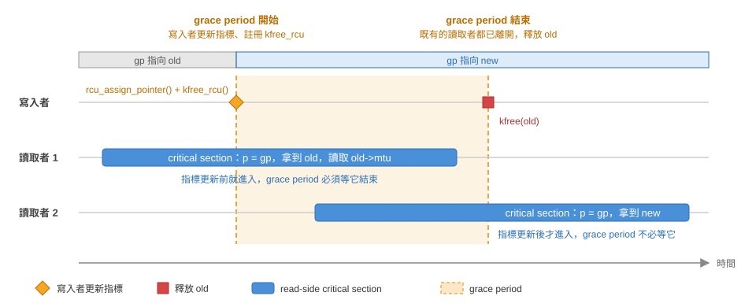
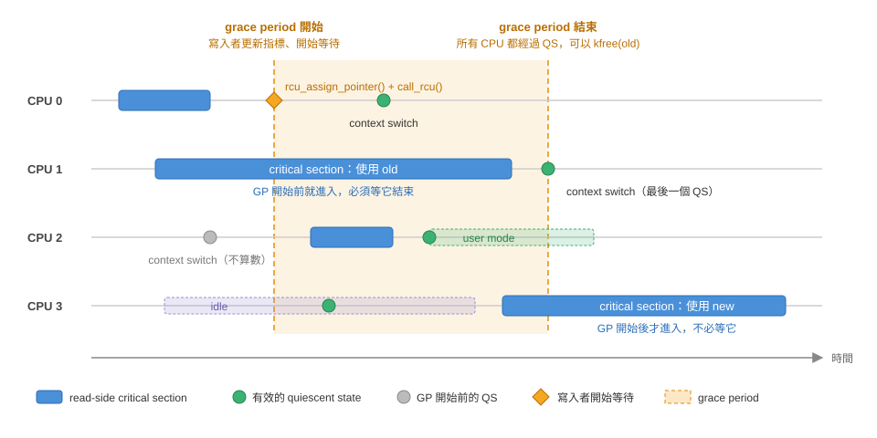
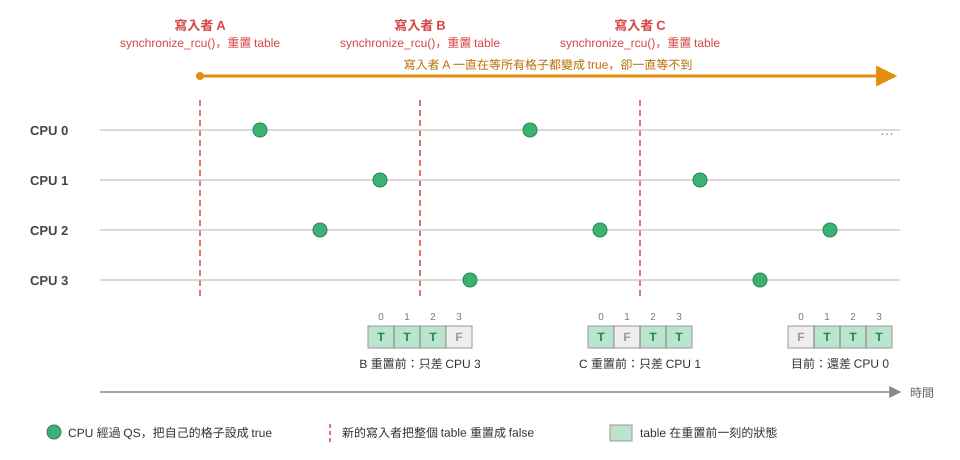
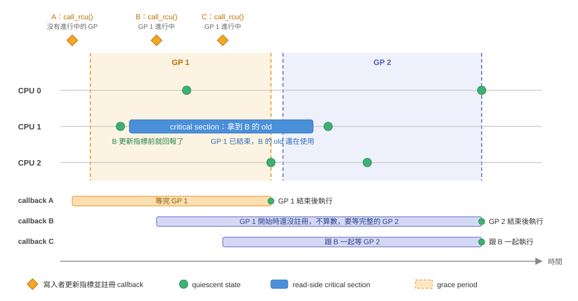
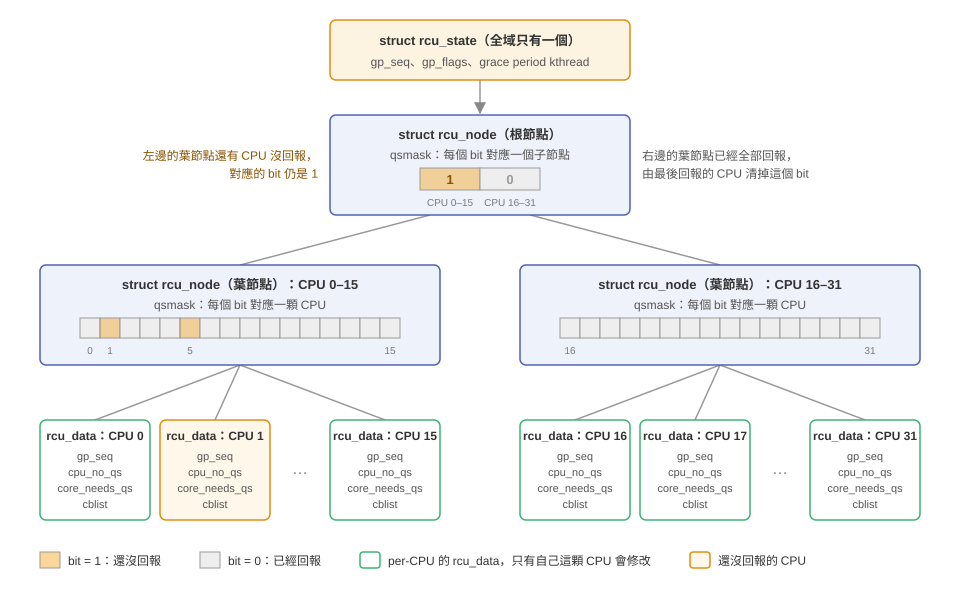
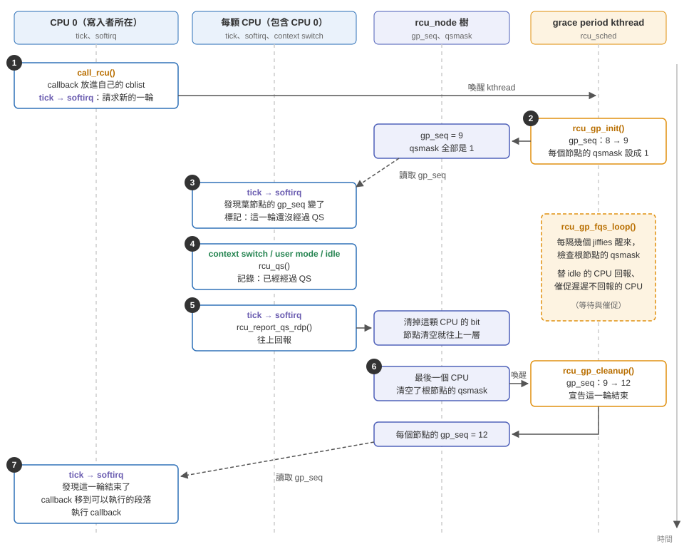

---
categories:
  - Linux
description: RCU（Read-Copy-Update）是 Linux kernel 用來保護讀多寫少資料的同步機制。本文以 Linux kernel 6.8.12 為基礎，從執行順序與生命週期問題講起，說明 RCU 的基本用法、grace period 與 quiescent state 的原理，以及 kernel 實作 RCU 的資料結構與整體流程。
tags:
  - 技術分享
  - 原始碼分析
date: 2026-11-20
title: Linux Kernel RCU 介紹
draft: false
---
RCU（Read-Copy-Update）是 Linux kernel 用來保護讀多寫少資料的同步機制。RCU 最常用到的場景是 Linux kernel 的 network stack，trace kernel code 時，經常可以看到要去讀取、遍歷某些資料結構的前後會出現 `rcu_read_lock` 跟 `rcu_read_unlock`，從字面上看起來是某種鎖定機制。通常在 trace code 了解  kernel 功能運作的時候，會直接忽略這些程式，今天就來看看它到底做了什麼。

<!-- more -->

我們經常可以看到這樣的 `rcu_read_lock` 跟 `rcu_read_unlock` 出現在 Linux kernel source code 中。

```c
rcu_read_lock();
dev = dev_get_by_index_rcu(net, ifindex);
if (dev)
    do_something(dev);
rcu_read_unlock();
```

network stack 有大量的資料結構具有讀多寫少的特性，如 iptables 的規則、routing table 等等。相對於每秒處理數萬、數十萬封包的讀取量，iptables 規則可能幾天甚至幾個月才會更新一次，因此 Linux 需要一種讀取端幾乎**零成本**的機制，確保在多核心系統上，讀取端總是能夠讀到**有效、完整**的資料。

本文以 Linux kernel 6.8.12 的原始碼為基礎，只討論不可搶佔 kernel（`CONFIG_PREEMPTION=n`）。這篇介紹 RCU 的概念與整體架構，實作部分則放在下一篇 [Linux Kernel RCU 原始碼解析](https://blog.louisif.me/posts/linux-kernel-rcu-implementation/)。

## 執行順序問題

RCU 主要解決的是兩個問題，第一個問題是編譯器與多核 CPU 架構造成的執行順序不一致問題。

假設 Kernel 裡面有一個全域變數保存 kernel 的設定：

```c
struct config *gp;
```

```c
struct config *p = kmalloc(sizeof(*p), GFP_KERNEL);
p->mtu = 1500;
p->flag = 1;
gp = p;
```

當其中一個 process 要更新設定時，寫入端會先建立一個新的 config 物件，然後再將全域指標 `gp` 指向新的物件，用意是確保讀取的 process 讀到的 config 物件一定是一個完整的版本，而不會 mtu 是新的但是 flag 是舊的版本。

```c
struct config *q = gp;
if (q)
    use(q->mtu);     /* 有機會讀到未初始化的值 */
```

讀取端在另一顆 CPU 上。直覺上，讀取端只要看到 `gp` 不是 NULL，`mtu` 應該就是新的數值 1500。但這個保證並不存在，原因有兩個。

第一個是編譯器。編譯器編譯時，只保證單執行緒的語意不變，對編譯器而言，寫入的 `p->mtu` 和 `gp` 是兩個不相關的記憶體位置，因此編譯器優化可以把 `gp = p` 移到 `p->mtu = 1500` 之前，導致讀取端可能讀到 `p->mut` 為 0;

另外編譯器也可以把一個普通的讀取拆成兩次、合併成一次，或乾脆快取在暫存器裡不再重讀。

> 除了重排之外，以下補充編譯器還可能做的幾種改寫。
>
> #### 1. 快取：把讀取提到迴圈外
>
> ```c
> while (!stop)
>     do_work();
> ```
>
> 如果 `do_work()` 被 inline，而且編譯器看得出它不會修改 `stop`，就可以合法地改寫成：
>
> ```c
> if (!stop)
>     for (;;)
>         do_work();
> ```
>
> `stop` 只讀一次放進暫存器，之後另一顆 CPU 把它設成 1，這個迴圈也永遠看不到，變成無窮迴圈。改成 `while (!READ_ONCE(stop))` 就會每次重新從記憶體讀取。
>
> #### 2. 重讀：把一次讀取變成兩次
>
> 這個情況跟 RCU 最直接相關。
>
> ```c
> struct config *p = gp;
> if (p)
>     use(p->mtu);
> ```
>
> `p` 是區域變數，看起來只讀了一次 `gp`。但編譯器假設沒有其他執行緒會同時修改 `gp`，所以「把 `p` 留在暫存器裡」跟「需要時再讀一次 `gp`」在它看來結果相同。暫存器不夠用時，與其把 `p` 先存到 stack 再讀回來，直接重讀 `gp` 反而更省，於是程式可能變成：
>
> ```c
> if (gp)
>     use(gp->mtu);
> ```
>
> 如果寫入端在兩次讀取之間把 `gp` 設成 NULL，第一次讀到非 NULL 通過檢查，第二次讀到 NULL，結果就是 NULL pointer dereference。同樣的問題也會出現在陣列索引上：先檢查 `idx < TABLE_SIZE`，實際存取時用的卻是重新讀出來、已經被別人改掉的值。
>
> #### 3. 合併：多次寫入只剩最後一次
>
> ```c
> x->state = STATE_BUSY;
> do_something_local();
> x->state = STATE_IDLE;
> ```
>
> 中間的程式碼如果不讀 `x->state`，編譯器可以刪掉第一筆寫入，只保留 `STATE_IDLE`。另一顆 CPU 若靠 `STATE_BUSY` 判斷「現在不能碰這個物件」，就永遠看不到這個狀態。

回到第二個原因：CPU 本身。現代 CPU 為了效能有 store buffer，寫入會先放進 buffer，之後再慢慢寫回 cache。這表示兩筆寫入被其他 CPU 看見的順序，可能跟發出的順序不同。x86 的 memory model（TSO）比較嚴格，不會重排兩筆 store；但 ARM64、POWER、RISC-V 都允許這種重排。

### Memory barrier

為了解決這個問題，我們需要使用 memory barrier。Memory barrier 是一種硬體或編譯器指令，它會強制記憶體的讀寫操作（load 與 store）要維持特定的執行與可見順序，防止指令被最佳化或亂序執行。

Linux kernel 提供了幾種不同強度的工具，定義在 `include/asm-generic/barrier.h` 與各架構的 `asm/barrier.h`：

| 工具 | 保證什麼 |
| --- | --- |
| `barrier()` | 只擋編譯器重排，不影響 CPU |
| `READ_ONCE()` / `WRITE_ONCE()` | 強迫編譯器恰好讀寫一次，不拆、不合併、不快取 |
| `smp_wmb()` / `smp_rmb()` | 前後的 store 對 store（或 load 對 load）不得重排 |
| `smp_mb()` | 全屏障，前後所有記憶體存取都不得跨越 |
| `smp_store_release()` | 這筆 store 之前的所有存取，都先於這筆 store 被看見 |
| `smp_load_acquire()` | 這筆 load 之後的所有存取，都晚於這筆 load |

其中 release 與 acquire 是一對概念。寫入端用 release 發布指標，等於聲明「我在這之前做的初始化都要先完成」；讀取端用 acquire 讀取指標，保證一定在做其他事情前完成指標的讀取。把上面的例子改成寫入端用 `smp_store_release(&gp, p)`、讀取端用 `smp_load_acquire(&gp)`，執行順序的問題就解決了。

> 對於 x86 架構而言，雖然 TSO 會確保 store 被其他 CPU 看見的順序跟發出的順序一致，但編譯器還是可能把寫入 `gp` 排到寫入 `p->mtu` 之前，所以仍然需要擋住編譯器。`smp_store_release()` 在 x86 架構下就是 `barrier()` + `WRITE_ONCE()`；同樣的邏輯，`smp_load_acquire()` 也就是 `READ_ONCE()` + `barrier()`。

## 生命週期問題

Memory barrier 解決了讀取資料正確性的問題。但只要資料會被修改或刪除，就還有另一個更棘手的問題：舊的物件什麼時候才能 free？

```c
struct config *p = kmalloc(sizeof(*p), GFP_KERNEL);
p->mtu = 1500;
p->flag = 1;
struct config *old = gp;
smp_store_release(&gp, p);   /* gp = p */
kfree(old);
```

同樣回到剛剛的 config 例子，`gp` 被更新成新設定後，我們當然要釋放舊 config。

```c
struct config *q = smp_load_acquire(&gp);
if (q)
    use(q->mtu);     /* 有機會讀到已經被釋放的記憶體 */
```

smp 系列的指令只確保了讀取 `q->mtu` 時，一定是 `smp_load_acquire` 這格時間讀取到的指標，但兩顆 CPU 的執行順序有可能是：

```c
// CPU1:
smp_store_release(&gp, p);   /* gp = p */
// CPU2:
struct config *q = smp_load_acquire(&gp);   /* 讀到的還是 old */
// CPU1:
kfree(old);
// CPU2:
if (q)
    use(q->mtu);
```

這樣 CPU2 讀取到的就是已經被 kfree 的記憶體，也就是典型的 use-after-free (UAF)。

最理所當然的方法是加上 read-write lock（`rwlock_t`），但這會有個嚴重的效能問題。

拿 read lock 這個動作本身是一次 atomic 寫入，來修改 lock 裡的計數器。當 64 顆 CPU 同時處理封包時，這個計數器所在的 cache line 會在所有 CPU 之間來回搬移（cache line bouncing），每次搬移都是數十到上百個 cycle。一個本來只需要幾次 cache hit 的 hash lookup，最後時間都花在等那個 cache line。

Per-CPU 的 lock 可以避開 bouncing，但寫入端就得一個一個 CPU 去拿，而且讀取端仍然要付出 atomic 操作與 barrier 的成本。我們想要的是讀取端完全不需要讀寫任何共享記憶體。

為了讀取端不用加鎖，寫入端就需要有機制能夠知道已經沒有人在用舊的資料了，才能夠把資料刪除。而且這個機制不能透過 reference count 之類的方式，不然又回到了每次讀取都要 atomic 寫入共享記憶體的問題。

RCU 提供的就是這樣一種讀取端無鎖的解決方案。

## RCU 的基本用法

RCU 用兩個機制分別對應前面的兩個問題：執行順序交給一組發布與讀取指標的 primitive，物件生命週期則交給 grace period，也就是「等所有既有的讀取者都離開」的這段等待時間，後面會詳細介紹。名稱中的 Read、Copy、Update 也正好描述了寫入端的做法：讀出舊資料、複製一份修改，再把指標更新過去。

最一開始我們先來看看 RCU 的使用範例：

```c
struct config {
    int mtu;
    struct rcu_head rcu;
};
static struct config __rcu *gp;     /* 假設初始化時已經指向一個有效的 config */
static DEFINE_SPINLOCK(cfg_lock);
```

首先，對於要用 RCU 延後釋放的資料結構，要加上 `struct rcu_head`，用途後面再說明。接著定義全域指標 `gp`，`__rcu` 標記讓靜態檢查工具 sparse 可以檢查這個指標有沒有被正確地透過 RCU API 存取。最後是寫入端之間互斥用的 `cfg_lock`。

```c
/* 讀取端：可以在任何 CPU、任何 context 同時執行 */
int get_mtu(void)
{
    struct config *p;
    int mtu = 0;

    rcu_read_lock();
    p = rcu_dereference(gp);
    if (p)
        mtu = p->mtu;
    rcu_read_unlock();
    return mtu;          /* 不能把 p 帶出 critical section */
}
```

對於讀取端而言，我們需要使用 `rcu_read_lock` 跟 `rcu_read_unlock` 包住需要讀取共享指標的程式，被包住的區塊稱為 read-side critical section。接著透過 `rcu_dereference` 讀取共享指標。

讀取的程式需要保證**只在 critical section 內**使用 `rcu_dereference` 返回的指標，並且在 critical section 內**不能睡眠**，也就是不能呼叫任何可能讓出 CPU、觸發 context switch 的函式。

只要做到這兩點，RCU 就保證在 critical section 內，`rcu_dereference` 返回的指標是有效的，不會被 kfree 等方式釋放掉。

```c
/* 寫入端：彼此之間仍然要用 lock 互斥 */
int set_mtu(int mtu)
{
    struct config *new, *old;

    new = kmalloc(sizeof(*new), GFP_KERNEL);
    if (!new)
        return -ENOMEM;

    spin_lock(&cfg_lock);
    old = rcu_dereference_protected(gp, lockdep_is_held(&cfg_lock));
    *new = *old;                   /* Copy */
    new->mtu = mtu;                /* Update */
    rcu_assign_pointer(gp, new);   /* Publish */
    spin_unlock(&cfg_lock);

    kfree_rcu(old, rcu);           /* 等既有的讀取者都離開後才真正 free */
    return 0;
}
```

接著看到寫入端。RCU 處理多個寫入端之間的 race condition，因此寫入端之間還是需要透過 `spin_lock` 之類的鎖，確保不會有多個寫入者同時修改。

首先寫入端準備好要寫入的新資料指標 `new`、透過 `rcu_dereference_protected` 取得之後要釋放的舊資料指標 `old`，並完成新資料的設置。

接著透過 `rcu_assign_pointer` 更新全域指標 `gp`，從這一刻起，新的讀取者拿到的都會是 `new`。但在這之前就已經拿到 `old` 的讀取者可能還在使用它，所以 `old` 不能馬上 free，必須等到這些讀取者都離開 read-side critical section。這段等待的時間就是前面提到的 grace period。

寫入端有兩種方式等待 grace period：

```c
/* 方式一：同步等待 */
rcu_assign_pointer(gp, new);
synchronize_rcu();          /* 睡眠，直到 grace period 結束才返回 */
kfree(old);

/* 方式二：註冊 callback，立刻返回 */
static void config_free_rcu(struct rcu_head *head)
{
    struct config *p = container_of(head, struct config, rcu);
    kfree(p);
}

rcu_assign_pointer(gp, new);
call_rcu(&old->rcu, config_free_rcu);   /* grace period 結束後才會呼叫 config_free_rcu */
```

`synchronize_rcu` 會讓呼叫的人睡眠，直到 grace period 結束才返回，寫起來最直覺，但只能用在可以睡眠的 context。`call_rcu` 則是把「grace period 結束後要做的事」包成一個 callback 交給 RCU，自己立刻返回，所以在 softirq 這類不能睡眠的地方也能使用。network stack 大多數的路徑都不能睡眠，因此 `call_rcu` 系列的用法更常見。

`struct rcu_head` 就是給 callback 用的。它裡面只有一個 `next` 指標跟一個函式指標，RCU 會用它把等待刪除物件的 callback 串成 linked list。因為它直接嵌在要釋放的物件裡，註冊 callback 的時候不需要另外配置記憶體，callback 被呼叫時再用 `container_of` 找回外層的物件。

範例中的 `kfree_rcu(old, rcu)` 是方式二最常見的特例：kernel 直接提供 API 來 kfree 整個物件，連 callback 函式都不用寫。它跟 `call_rcu` 一樣會立刻返回，不會讓寫入端睡眠。

對於使用者來說，RCU 跟一般 read-write lock 最大的差別在於對讀取端而言，`rcu_read_lock` 幾乎完全零成本，解決了上鎖的效能問題，同時保證讀取者一定讀到有效的資料，不會有 use-after-free 的問題。

### 補充：RCU 不保證所有讀取者看到同一個版本

當寫入者使用 `rcu_assign_pointer` 更新資料後，新的讀取者使用 `rcu_dereference` 取得的就會是新的指標。但是在 `rcu_assign_pointer` 執行前，已經透過 `rcu_dereference` 取得 `old` 指標的讀取者，可以在 critical section 結束前繼續讀取 `old` 的內容。因此同一個時間點可能有兩個讀取者讀到不同版本的資料，RCU 只保證資料的有效性，不保證所有讀取者在同一時間看到同一個版本。



讀取者 1 在指標更新之前就進入 critical section，拿到的是 `old`；讀取者 2 在更新之後才進入，拿到的是 `new`。grace period 需要等讀取者 1 這種「在更新之前就開始」的讀取者離開，`old` 才能釋放。讀取者 2 拿到的本來就是新指標，`old` 被釋放跟它無關，所以就算它比 grace period 晚結束也沒關係。

## RCU 的實現原理

前面說到，RCU 要解決的是兩個問題，第一個是執行順序、第二個是物件的生命週期，也就是舊物件什麼時候才能釋放。

對於第一個問題，memory barrier 已經提供了完整的解決方案，RCU 只是把它們包裝起來。`rcu_assign_pointer` 在 6.8.12 的實作就是 `smp_store_release`：

```c
/* include/linux/rcupdate.h */
#define rcu_assign_pointer(p, v)                                         \
do {                                                                     \
    ...                                                                  \
    if (__builtin_constant_p(v) && (_r_a_p__v) == (uintptr_t)NULL)       \
        WRITE_ONCE((p), (typeof(p))(_r_a_p__v));   /* 設成 NULL 不需要 barrier */ \
    else                                                                 \
        smp_store_release(&p, RCU_INITIALIZER((typeof(p))_r_a_p__v));    \
} while (0)

#define __rcu_dereference_check(p, local, c, space)                      \
({                                                                       \
    /* Dependency order vs. p above. */                                  \
    typeof(*p) *local = (typeof(*p) *__force)READ_ONCE(p);               \
    ...                                                                  \
    ((typeof(*p) __force __kernel *)(local));                            \
})
```

讀取端比較不一樣，`rcu_dereference` 用的不是 `smp_load_acquire`，而是更輕量的 `READ_ONCE`。這是因為讀取端接下來的存取都是「透過剛讀到的指標」去讀，例如 `p->mtu`，CPU 必須先拿到 `p` 的值才算得出 `p->mtu` 的位址，所以這兩筆讀取天生就不會被重排，這稱為 address dependency。除了已經很少見的 Alpha 之外，所有架構的 CPU 都遵守這個順序，`READ_ONCE` 只需要擋住前面提到的編譯器重讀問題就夠了。

所以 RCU 的精華還是在第二個問題：無鎖情況下，寫入端怎麼知道舊物件什麼時候可以釋放。

前面有說，讀取者只要離開了 critical section，就不允許繼續使用 `rcu_dereference()` 拿到的指標。所以問題是寫入者怎麼知道所有人都離開了 critical section。

在 read-side critical section 中，讀取者不能睡眠；而本文討論的是不可搶佔的 kernel，執行中的程式也不會被其他 process 搶走 CPU。也就是說，讀取者在 critical section 裡一定不會發生 context switch。反過來說，只要一顆 CPU 發生了 context switch，就表示這顆 CPU 上原本的讀取者一定已經離開了 read-side critical section。同樣地，CPU 正在執行 user space 程式，或是處於 idle 狀態時，也一定不在 critical section 裡。

要注意的是，硬體中斷不算在內。中斷可以打斷 critical section，中斷處理完後會回到原本的讀取者繼續執行，所以「發生過中斷」不代表讀取者已經離開。

所以當寫入者呼叫 `synchronize_rcu` 或 `call_rcu` 之後，只要等到所有 CPU 都至少經歷過一次 context switch、user mode 或 idle，就知道所有可能持有舊指標的讀取者都已經離開了 read-side critical section，不存在任何對舊指標的引用，可以刪除資料了。

這裡有兩個名詞：

Quiescent state（QS）指的是 CPU 確定不在任何 read-side critical section 裡的狀態，也就是上面說的 context switch、user mode 與 idle。

Grace period 則是從寫入者完成指標更新、開始等待之後，到所有 CPU 都經歷過至少一次 quiescent state 為止的這段時間。Grace period 結束時，所有在它開始前就已存在的 read-side critical section 都必定已經結束，舊物件也就可以安全 free。

下面用四顆 CPU 的例子，看看這兩個名詞之間的關係：



CPU 0 上的寫入者呼叫 `rcu_assign_pointer` 把 `gp` 換成新的物件，接著用 `call_rcu` 註冊釋放 `old` 的 callback，grace period 就從這裡開始。從這一刻起，RCU 要等每一顆 CPU 都經過至少一次 quiescent state。CPU 0 自己之後發生了一次 context switch，它的部分就完成了。

CPU 1 是 grace period 真正要等的對象。它在指標更新之前就進入了 critical section，手上可能拿著 `old`，所以必須等它離開 critical section。它離開之後發生的 context switch，是這一輪最後一個 quiescent state，grace period 在這個時間點結束，`old` 才可以被釋放。

CPU 2 在 grace period 開始之前也發生過一次 context switch，但這次不算數。因為在那之後、指標更新之前，CPU 2 還是可能進入新的 critical section 並拿到 `old`。CPU 2 在 grace period 開始後進入的 critical section 拿到的已經是新指標，但 RCU 沒辦法得知這一點，所以仍然要等到它進入 user mode，才把它算進這一輪的 quiescent state。

CPU 3 在 grace period 開始時正處於 idle，idle 本身就是 quiescent state，所以這一輪一開始，它就已經滿足條件。它之後進入的 critical section 拿到的是新指標，跟前面的讀取者 2 一樣，grace period 不需要等它。

從這個例子可以看出，grace period 保證的是「開始之前就存在的讀取者都已經結束」，而不是「當下沒有任何讀取者」。RCU 不需要知道每個 CPU 是不是實際讀取過舊版本的指標，只要確認每顆 CPU 都經過一次 quiescent state 就夠了。代價是 grace period 有時會比實際需要的長。以 CPU 2 為例，如果它進入 user mode 的時間比 CPU 1 的 context switch 還晚，grace period 就得跟著延後，即使 CPU 2 手上根本沒有 `old`。

### 讀取端實現

剛說到 RCU 能用 context switch 判斷讀取者已經離開 critical section，前提是 critical section 內不會發生搶佔（preempt）。因此 `rcu_read_lock` 跟 `rcu_read_unlock` 做的事情就只是在進入時關閉搶佔（`preempt_disable()`）、離開時開啟搶佔（`preempt_enable()`）：

```c
/* include/linux/rcupdate.h，!CONFIG_PREEMPT_RCU */
static inline void __rcu_read_lock(void)
{
    preempt_disable();
}

static inline void __rcu_read_unlock(void)
{
    preempt_enable();
    ...
}
```

而在不可搶佔的 kernel 裡，本來就不會發生搶佔，`preempt_disable()` 只被定義成 `barrier()`：

```c
/* include/linux/preempt.h，!CONFIG_PREEMPT_COUNT */
#define preempt_disable()       barrier()
#define preempt_enable()        barrier()
```

也就是說，`rcu_read_lock` 編譯出來連一道指令都沒有，只是阻止編譯器把 critical section 裡的存取搬到外面。這就是 RCU 讀取端「零成本」的由來：所有的成本都轉移到寫入端，由寫入端負責判斷什麼時候才能安全地釋放記憶體。

### Grace period 原理

判斷 grace period 結束的邏輯則複雜得多，首先要說明為什麼 grace period 是一輪一輪進行的。

想要判斷是不是每顆 CPU 都已經歷過一次 quiescent state，最直接的方法當然就是維護一個全域的 bool table，每個格子表示對應的 CPU 經歷過一次 quiescent state。當有寫入者呼叫 `synchronize_rcu` 時，把 bool table 全部設為 false；CPU 經過 quiescent state 時，把對應的格子更新為 true。然後有個背景程式持續檢查是不是所有格子都被設為 true，就知道 grace period 結束了，可以喚醒等待中的寫入者。

這裡有一個顯而易見的問題：如果有許多寫入者輪流呼叫 `synchronize_rcu`，bool table 就會一直被重置，導致先來的寫入者遲遲等不到結束。



每個新來的寫入者都會把累積的進度歸零。只要寫入間隔比「所有 CPU 都經過一次 quiescent state」還短，table 就永遠不會全部變成 true，寫入者 A 也就一直等不到。

因此 RCU 把 grace period 設計成一輪一輪地進行。

寫入者呼叫 `synchronize_rcu` 或 `call_rcu` 時，並不會自己去重置 bool table，而是把一個 callback 放進 queue，表示「有人在等 grace period」。RCU 背景程式知道有 callback 在等，就開始新的一輪 grace period，重置 bool table，等待所有 CPU 進入過 quiescent state。這一輪結束後，在它開始前就排隊的 callback 就可以執行了。`call_rcu` 的 callback 就是寫入者指定的函式；`synchronize_rcu` 則是註冊一個「喚醒自己」的 callback 之後睡著等。

在等待的過程中，如果有其他寫入者註冊 callback，就會被放在 queue 裡。等到當前進行中的這一輪結束，背景程式才會為它們開始新的一輪。

注意這裡的 grace period 跟前面的定義已經有一點不同。前面是從單一寫入者的角度，把 grace period 說成從它開始等待算起；實際上 grace period 是一輪一輪進行的，寫入者真正要等的，是一輪在它註冊之後才開始、而且完整結束的 grace period。

之所以新來的 callback 不能搭上正在進行中的這一輪，是因為這一輪在它的指標更新之前就開始了。某顆 CPU 可能在指標更新之前就已經回報過 quiescent state，接著才進入新的 critical section、拿到舊指標，而正在進行的這一輪不會再等這顆 CPU。所以 callback 最多要等兩輪 grace period：正在進行的這一輪，以及下一個完整的一輪。



callback A 註冊時沒有進行中的 grace period，只要等 GP 1 就好。callback B 則是在 GP 1 進行中註冊的，問題就出在 CPU 1 身上：CPU 1 在 B 更新指標之前就已經回報過 quiescent state，之後才進入 critical section，拿到 B 要釋放的舊物件。GP 1 不會再等 CPU 1，所以 GP 1 結束時，CPU 1 還在使用 B 的舊物件。如果 B 搭上了 GP 1，這時執行 B 的 callback 就會造成 use-after-free。所以 B 必須等 GP 1 結束後，再完整跑完 GP 2，同樣在 GP 1 期間註冊的 C 也跟著 B 一起等 GP 2。

這個設計也帶來一個很大的好處：同一輪 grace period 可以同時滿足所有在它開始前排隊的 callback。不管這段時間有一個還是上萬個 callback，等待的成本都只有一輪。對於寫入佔比極低的資料結構來說，多等一點時間是可以接受的。

### Grace period 的資料結構與角色
前面概念上的 bool table，在 kernel 裡對應的是一棵 `struct rcu_node` 樹上的 `qsmask`。Linux kernel 使用 `struct rcu_state` 這個全域結構，記錄目前的 grace period 序號 `gp_seq`。底下是一棵 `struct rcu_node` 樹，每個節點用 `qsmask` 的一個 bit 代表一個尚未回報通過 quiescent state 的子節點或 CPU，每個節點也各自記錄一份 `gp_seq`。

之所以要做成樹，是因為如果所有 CPU 都去設置同一個全域 bitmask，就得搶同一個 lock，這個 lock 所在的 cache line 會在所有 CPU 之間來回搬移，跟前面 read lock 的 cache line bouncing 是同一類問題。做成樹之後，每顆 CPU 只鎖自己所屬的葉節點（預設每個葉節點涵蓋 16 顆 CPU），只有當一個節點的 `qsmask` 全部清空時，才由最後一個回報的 CPU 往上層回報。

最下面每顆 CPU 還有獨立的 `struct rcu_data`，記錄這顆 CPU 目前知道的 grace period 序號（`gp_seq`）、這一輪是否還需要它回報（`core_needs_qs`）、這一輪是否還沒經過 quiescent state（`cpu_no_qs`，true 表示還沒），以及它的 callback queue（`cblist`）。

所以 `gp_seq` 其實有三份：`rcu_state` 一份、每個 `rcu_node` 各一份、每顆 CPU 的 `rcu_data` 各一份。背景程式（也就是後面介紹的 grace period kthread）負責更新 `rcu_state` 與 `rcu_node` 裡的 `gp_seq`；每顆 CPU 則拿自己 `rcu_data` 裡的那份，跟所屬葉節點的那份比較，不一樣就表示有一輪開始或結束了。

前面「Grace period 原理」為了好理解，把 callback queue 講成只有一個。實際上它是分散在每顆 CPU 上的：寫入者在哪顆 CPU 上呼叫 `call_rcu()`，callback 就放進那顆 CPU 的 `cblist`。這樣註冊 callback 時不用跟其他 CPU 搶同一個 queue 的 lock，queue 的細節留到下一篇的「Callback 的實現」再說明。

`rcu_data` 有一條重要的規則：記錄 grace period 進度的欄位（`gp_seq`、`cpu_no_qs`、`core_needs_qs`）與 callback queue，只由那顆 CPU 自己修改，其他 CPU 和背景程式都不會去寫它們。這樣 CPU 更新自己的狀態時，不用擔心跟別人同時修改而產生 race condition，也就不需要加鎖或使用 atomic 操作。需要跟其他 CPU 共享的資訊，例如「我已經經過 QS 了」，則透過有 lock 保護的 `rcu_node` 樹往上傳遞。

下圖以 32 顆 CPU 為例，畫的是一輪 grace period 進行到一半的狀態：



CPU 數量不多時（不超過 16 顆），整棵樹只會有一個節點，它同時是根節點也是葉節點。

資料結構有了，接下來的問題是：誰來更新這些資料？在 kernel 裡，這些工作分別由三個角色負責，它們在下一篇的程式碼裡會不斷出現，所以先簡單介紹。

第一個是 grace period kthread。kthread 是只在 kernel 裡執行的 thread，跟一般 process 一樣會被排程、可以睡眠。前面「Grace period 原理」提到的背景程式就是它，在不可搶佔的 kernel 裡它的名字叫 `rcu_sched`。它負責宣告一輪 grace period 的開始與結束，也就是更新 `rcu_state` 與 `rcu_node` 樹。

但 kthread 只是一個 thread，同一時間只會跑在一顆 CPU 上，而且依照前面提到的 `rcu_data` 規則，它不能去改其他 CPU 記錄 grace period 進度的欄位。所以每顆 CPU 必須自己發現新的一輪開始了，自己記錄有沒有經過 quiescent state，再自己往上回報。這就需要每顆 CPU 都有機會定期執行一小段 RCU 的程式碼。

這個機會來自第二個角色：tick。tick 是每顆 CPU 各自的計時器中斷，每秒觸發 `HZ` 次（常見的設定是 250 或 1000），kernel 原本就靠它更新時間、計算 process 用掉的 CPU 時間，以及判斷是否該切換 process。RCU 只是在 tick 的處理函式裡加了一小段檢查，不需要額外產生中斷，就能讓每顆 CPU 定期看一下自己有沒有 RCU 的工作要做。kernel 也用全域變數 `jiffies` 記錄開機以來經過了幾個 tick，1 個 jiffy 就是 1/`HZ` 秒，下一篇提到「幾個 jiffies」指的就是這個時間單位。

本文的主線先假設每顆 CPU 都持續收到 tick。現在常見的 `CONFIG_NO_HZ_IDLE` 設定會在 CPU idle 時停掉 tick，這個情況放在下一篇的最後補充。

不過硬體中斷的處理函式應該盡量短，比較花時間、需要拿 lock 的工作，kernel 會延後到第三個角色 softirq 裡做。熟悉 network stack 的話應該對它不陌生：網卡收到封包時，硬體中斷只做最少的事，真正的封包處理是在 `NET_RX_SOFTIRQ` 裡完成的。softirq 會在硬體中斷處理完、準備返回之前執行，這時中斷已經重新打開，可以處理比較重的工作。RCU 也有自己的 softirq，叫做 `RCU_SOFTIRQ`，tick 發現有事要做時就觸發它，往上回報、執行 callback 這些工作都在裡面完成。

最後看一輪 grace period 從開始到結束，這三個角色各自做了什麼：

1. 寫入者呼叫 `call_rcu()`，callback 被放進這顆 CPU 的 `cblist`。因為 kthread 不會去看每顆 CPU 的 queue，所以是由這顆 CPU 在 tick 時發現自己有 callback 在等 grace period，主動請求開始新的一輪，喚醒 kthread。
2. kthread 推進 `gp_seq`，並把整棵樹的 `qsmask` 設成「所有 CPU 都還沒回報」。
3. 每顆 CPU 在 tick 時發現 `gp_seq` 變了，在觸發的 softirq 裡把自己的 `core_needs_qs` 標記成「這一輪還沒經過 QS」。
4. CPU 之後經過 context switch、user mode 或 idle 時，使用 `cpu_no_qs` 記錄自己已經經過 QS。
5. CPU 在下一次 tick 觸發的 softirq 裡，發現自己經歷了 QS 而且還沒回報，就沿著 `rcu_node` 樹往上回報，清掉自己在 `qsmask` 裡的 bit。
6. 最後一個回報的 CPU 清空了根節點的 `qsmask`，喚醒 kthread。kthread 推進 `gp_seq`，宣告這一輪結束。
7. 每顆 CPU 發現這一輪結束，把等待這一輪的 callback 移到「可以執行」的位置，在 softirq 裡執行它們。

> 如果有 CPU 在步驟 4、5 遲遲沒有動作，kthread 也不會只是被動地等，它會在等待期間主動檢查、催促這些 CPU。這部分的機制在下一篇說明。



圓圈裡的數字對應上面的步驟，圖中的函式名稱會在下一篇依序介紹。除了步驟 1 與 6 透過 `rcu_state` 的 `gp_flags` 喚醒 kthread 之外，CPU 與 kthread 之間不直接交換資料，其餘共享的狀態都放在中間的 `rcu_node` 樹上。步驟 3 到 5 每顆 CPU 都會各自走一次，彼此不需要等待，圖中只畫出其中一顆。

## 小結

以上就是 RCU 的整體概念架構。讀取端只是關閉搶佔，幾乎沒有成本；寫入端把舊物件的釋放交給 callback，等一輪在它註冊之後才開始的 grace period 結束再執行。kernel 用 `rcu_state`、`rcu_node` 樹與每顆 CPU 的 `rcu_data` 記錄每一輪的進度，由 grace period kthread 宣告一輪的開始與結束，每顆 CPU 則在 tick 與 softirq 裡發現新一輪、記錄並回報 quiescent state、執行 callback。

上面七個步驟在原始碼裡是怎麼實作的，例如 `gp_seq` 怎麼編碼、CPU 怎麼沿著 `rcu_node` 樹往上回報、callback queue 怎麼依照 grace period 分段，留到下一篇 [Linux Kernel RCU 原始碼解析](https://blog.louisif.me/posts/linux-kernel-rcu-implementation/)再逐一說明。
